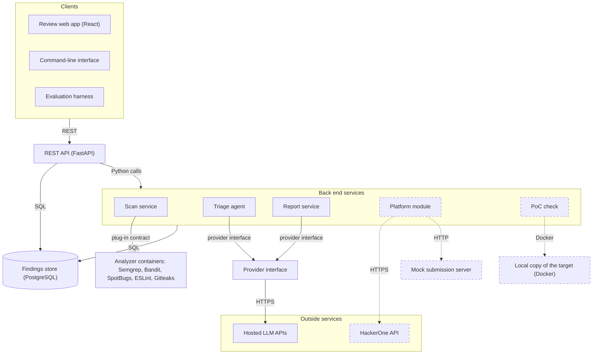

# Architecture

Sieve runs on the researcher's machine as a Docker Compose deployment. This document has two views: the components and the interfaces between them, and the containers they run in. It refines Figure 2 of the project proposal.

## Component view

Dashed boxes and arrows are stretch goals.

| Component | What it does | Interfaces | Task |
|---|---|---|---|
| Review web app | Shows the review queue and each finding with the AI's verdict, reasoning and cited code. A person approves, rejects or edits each finding and previews its report. | REST | T5.1 |
| Command-line interface | Starts a scan of a repository and lists its findings. | REST | T2.4 |
| Evaluation harness | Runs the benchmarks and computes the metrics. | REST | T6.1 |
| REST API | One API for all three clients. FastAPI generates its OpenAPI specification. It refuses to export a report for a finding that is not approved. | REST, Python calls, SQL | T2.3 |
| Scan service | Checks the scope file, runs one container per analyzer, converts each SARIF file to our finding format with that tool's adapter, and stores the findings. | plug-in contract, SQL | T2.1, T2.2 |
| Triage agent | Groups duplicates, checks each finding for false positives and scores its severity. | triage API (docs/interfaces.md), provider interface, SQL | T3.2 to T3.4 |
| Report service | Writes reports for approved findings and exports them as Markdown. | report schema (docs/interfaces.md), provider interface, SQL | T4.1 |
| Provider interface | The only way to reach an LLM. It renders prompt templates, answers repeated requests from the cache, tracks cost, enforces the run's budget and logs every call. | provider interface (docs/class-diagrams.md), HTTPS | T3.1 |
| Findings store | PostgreSQL tables for scans, findings, locations, duplicate groups, verdicts, reviews, reports and LLM calls. | SQL (docs/database.md) | T2.3 |
| Analyzer containers | One container per analyzer, with no network access except the build step of the Java plug-in. | plug-in contract | T2.1 |
| Platform module (stretch) | Imports a program's scope through the HackerOne Hacker API, and submits reports only to a mock server. | HTTPS, HTTP | T5.3, T5.4 |
| PoC check (stretch) | Runs a PoC against a local Docker copy of the target and marks the finding as verified. | Docker | T4.3 |

The REST API and the services are modules of one Python back end (proposal, Table 2), so they call each other directly. Scans and triage runs take minutes, so the API starts them as background jobs and returns right away, and the clients read each job's status. The deployment view shows where these jobs run.

Only two kinds of data leave the researcher's machine: requests to the hosted LLM APIs, which all go through the provider interface, and, as a stretch goal, requests to the HackerOne API. Analyzer containers have no network access. The data flow diagram (docs/data-flow.md) lists exactly what each request contains.

## Deployment view

To be written by Ali.
