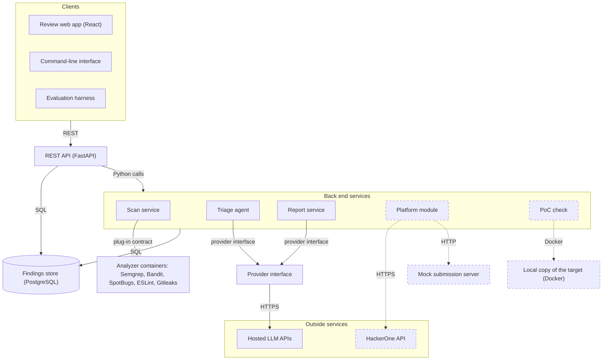
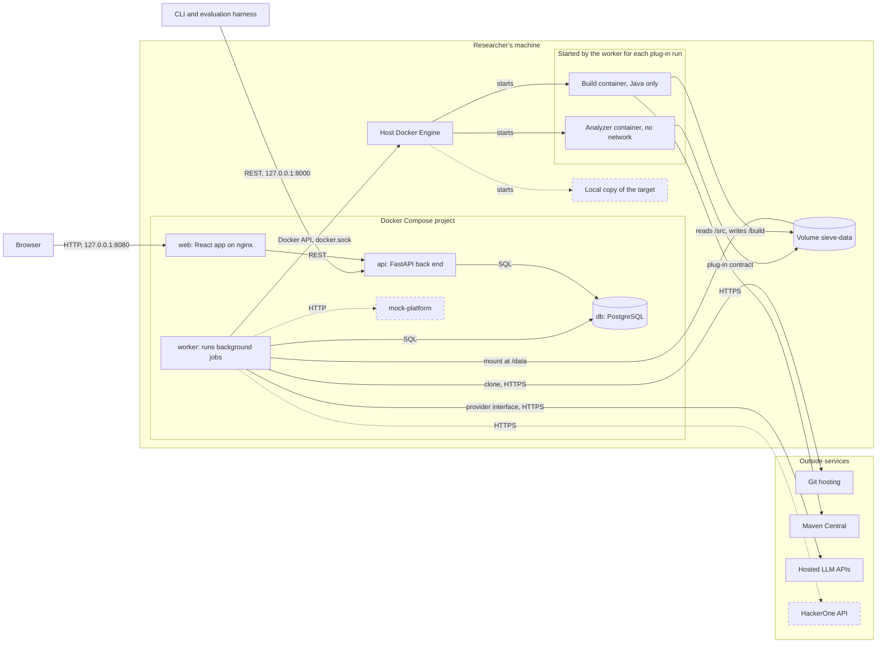

# Architecture

Sieve runs on the researcher's machine as a Docker Compose deployment. This document has two views: the components and the interfaces between them, and the containers they run in. It refines Figure 2 of the project proposal.

## Component view

Dashed boxes and arrows are stretch goals.

| Component | What it does | Interfaces | Task |
|---|---|---|---|
| Review web app | Shows the review queue and each finding with the AI's verdict, reasoning and cited code. A person approves, rejects or edits each finding and previews its report. | REST | T5.1 |
| Command-line interface | Starts a scan of a repository and lists its findings. | REST | T2.4 |
| Evaluation harness | Runs the benchmarks and computes the metrics. | REST | T6.1 |
| REST API | One API for all three clients. FastAPI generates its OpenAPI specification. It refuses to export a report for a finding that is not approved. | REST, Python calls, SQL | T2.3 |
| Scan service | Checks the scope file, runs one container per analyzer, converts each SARIF file to our finding format with that tool's adapter, and stores the findings. | plug-in contract, SQL | T2.1, T2.2 |
| Triage agent | Groups duplicates, checks each finding for false positives and scores its severity. | triage API (docs/interfaces.md), provider interface, SQL | T3.2 to T3.4 |
| Report service | Writes reports for approved findings and exports them as Markdown. | report schema (docs/interfaces.md), provider interface, SQL | T4.1 |
| Provider interface | The only way to reach an LLM. It renders prompt templates, answers repeated requests from the cache, tracks cost, enforces the run's budget and logs every call. | provider interface (docs/class-diagrams.md), HTTPS | T3.1 |
| Findings store | PostgreSQL tables for scans, findings, locations, duplicate groups, verdicts, reviews, reports and LLM calls. | SQL (docs/database.md) | T2.3 |
| Analyzer containers | One container per analyzer, with no network access except the build step of the Java plug-in. | plug-in contract | T2.1 |
| Platform module (stretch) | Imports a program's scope through the HackerOne Hacker API, and submits reports only to a mock server. | HTTPS, HTTP | T5.3, T5.4 |
| PoC check (stretch) | Runs a PoC against a local Docker copy of the target and marks the finding as verified. | Docker | T4.3 |

The REST API and the services are modules of one Python back end (proposal, Table 2), so they call each other directly. Scans and triage runs take minutes, so the API starts them as background jobs and returns right away, and the clients read each job's status. The deployment view shows where these jobs run.

Only two kinds of data leave the researcher's machine: requests to the hosted LLM APIs, which all go through the provider interface, and, as a stretch goal, requests to the HackerOne API. Analyzer containers have no network access. The data flow diagram (docs/data-flow.md) lists exactly what each request contains.

## Deployment view

Sieve is one Docker Compose project with four services. The analyzer containers are not part of the project: the worker starts one for each plug-in run and removes it afterwards. Dashed boxes and arrows are stretch goals.

The `pgdata` and `m2-cache` volumes and the `./exports` folder are left out of the diagram to keep it readable. The tables below list them.

### Services

| Service | What runs in it | Ports | Networks | Volumes and secrets |
|---|---|---|---|---|
| `web` | the React app, built at image build time and served by nginx, which also forwards `/api` to `api` | 8080, bound to 127.0.0.1 | `frontend` | none |
| `api` | the FastAPI back end: the REST API, the review workflow and the Markdown export. It reads and writes the database, and puts long tasks in the job queue. It makes no outside calls. | 8000, bound to 127.0.0.1 | `frontend`, `backend` | `./exports` on the host, to write exported reports |
| `worker` | the same image as `api`, started with a different command. It takes jobs from the queue and runs scans, triage runs and report drafts. | none | `backend`, `egress` | `sieve-data`, the Docker socket, and the LLM API keys from `.env` |
| `db` | PostgreSQL. The version is pinned in T1.3. | none | `backend` | `pgdata` |
| `mock-platform` (stretch) | the mock submission server (T5.4), started only with the `stretch` Compose profile | none | `backend` | none |

Ports are bound to 127.0.0.1, so Sieve can't be reached from other machines on the network. Only `worker` gets the LLM API keys, because only the worker calls LLMs, and the keys come from an `.env` file that Git ignores (requirement N4).

### Background jobs

Scans and triage runs take minutes, so the API only records a job and returns its ID, and the clients read the job's status. The queue is a `jobs` table in PostgreSQL. The worker takes the oldest waiting job with `SELECT ... FOR UPDATE SKIP LOCKED`, so we need no other queue service such as Redis, and two workers never take the same job. One worker is enough for one researcher, and it runs up to two analyzer containers at a time. A job left as running when the worker stopped is marked as failed when the worker starts again, and the worker removes any analyzer container still labeled with that job's scan.

### Networks

| Network | Members | Outside access | Why |
|---|---|---|---|
| `frontend` | `web`, `api` | yes, Docker's default | the browser reaches `web`, and `web` forwards to `api` |
| `backend` | `api`, `worker`, `db`, `mock-platform` | no (`internal: true`) | the database can't be reached from outside the project and can't reach out |
| `egress` | `worker` | yes | clones of public repositories and calls to the LLM APIs |
| `sieve-build` | one build container at a time | yes | Maven downloads for the Java build step. No other container is on it, so the build can't reach the database or the back end. |
| none | every analyzer container | no | `--network none` (docs/interfaces.md) |

### Volumes

| Volume | Mounted in | Contents |
|---|---|---|
| `pgdata` | `db` | the database files |
| `sieve-data` | `worker` at /data, and parts of it in analyzer and build containers | `scans/<scan ID>/src` for the checkout, `runs/<run ID>/out` for the SARIF file, `runs/<run ID>/build` for the Java build, and `runs/<run ID>/log` |
| `m2-cache` | build containers at /cache/m2 | Maven's local repository, shared between scans so later builds download less |
| `./exports` | `api` | exported reports, as a folder on the host so the researcher can open them |

`sieve-data` is given the fixed name `sieve-data` with Compose's `name:` key, so the worker can refer to it when it starts containers.

### How the worker starts analyzer containers

The worker talks to the host's Docker Engine through the Docker socket, `/var/run/docker.sock`, mounted into the worker container. It uses the Docker SDK for Python, so the runner is plain Python code with no shell commands. The analyzer container is a sibling of the worker, not a container inside it.

Because the host's Docker Engine starts the container, a path inside the worker means nothing to it. The worker therefore mounts parts of the named volume with the `volume-subpath` option, which needs Docker Engine 26 or later:

    --mount type=volume,src=sieve-data,dst=/src,volume-subpath=scans/42/src,readonly
    --mount type=volume,src=sieve-data,dst=/out,volume-subpath=runs/7/out

The worker creates `runs/<run ID>/out` before the run and gives it to user 10001, which the plug-in runs as.

We considered three other ways:

| Option | Why we didn't choose it |
|---|---|
| Docker-in-Docker | needs a privileged container, which is root on the host as well, and a second Docker Engine to keep images in |
| A proxy in front of the socket that allows only some API calls | creating containers must stay allowed, and a created container can mount any host path, so the proxy limits little and adds a service |
| Rootless Docker or Podman on the host | the strongest option, but it is set up differently on Windows, macOS and Linux, and we want one installation guide. A researcher on Linux can still run Sieve this way. |

The trade-off: access to the Docker socket is the same as root access on the host. If the worker were taken over, the attacker could start a container that mounts the host's file system. We accept this risk because:

- Only the worker has the socket. The API, which the browser and CLI talk to, doesn't.
- The worker has no ports, so nothing can connect to it.
- The worker never runs code from the scanned repository. It only clones it, and Git doesn't run hooks from a cloned repository. The scanned code is read only by analyzers inside their own containers.
- The worker starts only images named in plug-in manifests, with the flags fixed in the runner's code. Requests from the API pass only IDs, never image names, paths or flags.
- Sieve runs on the researcher's own machine and listens only on 127.0.0.1.
