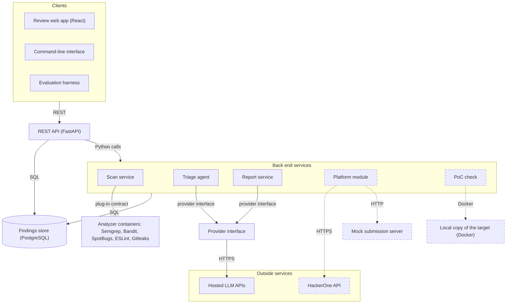
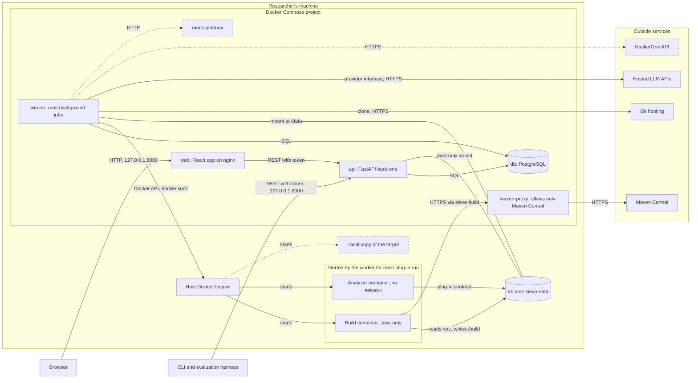

# Architecture

Sieve runs on the researcher's machine as a Docker Compose deployment. This document has two views: the components and the interfaces between them, and the containers they run in. It refines Figure 2 of the project proposal.

## Component view

Dashed boxes and arrows are stretch goals.

| Component | What it does | Interfaces | Task |
|---|---|---|---|
| Review web app | Shows the review queue and each finding with the AI's verdict, reasoning and cited code. A person approves, rejects or edits each finding and previews its report. | REST | T5.1 |
| Command-line interface | Starts a scan of a repository and lists its findings. | REST | T2.4 |
| Evaluation harness | Runs the benchmarks and computes the metrics. | REST | T6.1 |
| REST API | One API for all three clients. FastAPI generates its OpenAPI specification. It refuses to export a report for a finding that is not approved. | REST, Python calls, SQL | T2.3 |
| Scan service | Checks the scope file, runs one container per analyzer, converts each SARIF file to our finding format with that tool's adapter, and stores the findings. | plug-in contract, SQL | T2.1, T2.2 |
| Triage agent | Groups duplicates, checks each finding for false positives and scores its severity. | triage API (docs/interfaces.md), provider interface, SQL | T3.2 to T3.4 |
| Report service | Writes reports for approved findings and exports them as Markdown. | report schema (docs/interfaces.md), provider interface, SQL | T4.1 |
| Provider interface | The only way to reach an LLM. It renders prompt templates, answers repeated requests from the cache, tracks cost, enforces the run's budget and logs every call. | provider interface (docs/class-diagrams.md), HTTPS | T3.1 |
| Findings store | PostgreSQL tables for scans, findings, locations, duplicate groups, verdicts, reviews, reports and LLM calls. | SQL (docs/database.md) | T2.3 |
| Analyzer containers | One container per analyzer, with no network access except the build step of the Java plug-in. | plug-in contract | T2.1 |
| Platform module (stretch) | Imports a program's scope through the HackerOne Hacker API, and submits reports only to a mock server. | HTTPS, HTTP | T5.3, T5.4 |
| PoC check (stretch) | Runs a PoC against a local Docker copy of the target and marks the finding as verified. | Docker | T4.3 |

The REST API and the services are modules of one Python back end (proposal, Table 2), so they call each other directly. Scans and triage runs take minutes, so the API starts them as background jobs and returns right away, and the clients read each job's status. The deployment view shows where these jobs run.

Only two kinds of data leave the researcher's machine: requests to the hosted LLM APIs, which all go through the provider interface, and, as a stretch goal, requests to the HackerOne API. Analyzer containers have no network access. The data flow diagram (docs/data-flow.md) lists exactly what each request contains.

## Deployment view

Sieve is one Docker Compose project with five services. The analyzer and build containers are not part of the project: the worker starts them for each plug-in run and removes them afterwards. Dashed boxes and arrows are stretch goals.

The `pgdata` volume, the Maven cache volumes, the scope file and the `./exports` folder are left out of the diagram to keep it readable. The tables below list them.

### Services

| Service | What runs in it | Ports | Networks | Volumes and secrets |
|---|---|---|---|---|
| `web` | the React app, built at image build time and served by nginx. nginx forwards `/api` to `api` and adds the API token. It answers only requests whose `Host` is `localhost` or `127.0.0.1`. | 8080, bound to 127.0.0.1 | `frontend` | the API token from `.env` |
| `api` | the FastAPI back end: the REST API, the scope check, the review workflow and the Markdown export. It reads and writes the database, puts long tasks in the job queue, and reads checkouts to show cited code on the review screen. | 8000, bound to 127.0.0.1 | `frontend`, `backend` | `./exports` on the host, the scope file and `sieve-data` read-only, and the API token from `.env` |
| `worker` | the same image as `api`, started with a different command. It takes jobs from the queue and runs scans, triage runs and report drafts. | none | `backend`, `egress` | `sieve-data`, the Docker socket, the scope file read-only, and the LLM API keys from `.env` |
| `maven-proxy` | a small forward proxy that allows connections only to Maven Central, for the Java build step (docs/interfaces.md) | none | `sieve-build`, `egress` | none |
| `db` | PostgreSQL. The version is pinned in T1.3. | none | `backend` | `pgdata` |
| `mock-platform` (stretch) | the mock submission server (T5.4), started only with the `stretch` Compose profile | none | `backend` | none |

Ports are bound to 127.0.0.1, so Sieve can't be reached from other machines on the network.

Secrets come from an `.env` file that Git ignores (requirement N4). The installation script creates it, with a random API token:

- Only `worker` gets the LLM API keys, because only the worker calls LLMs.
- The API requires the token on every request, and checks the `Host` header. Only nginx and the CLI have the token. A container started by Sieve can't reach the API (docs/interfaces.md), and a web page that the researcher visits can't use it through DNS rebinding, because its requests carry another `Host`.

`api` is on the `frontend` network, which has outside access, because Docker doesn't publish ports from an internal network. That the API makes no outside calls is a rule in its code, not something the network enforces.

On Linux, `api` runs as the researcher's own user (`user: "${UID}:${GID}"`), and the installation guide creates `./exports` before the first start. Otherwise Docker creates the folder as root, and the researcher can't edit or delete the exported reports without `sudo`.

### Background jobs

Scans and triage runs take minutes, so the API only records a job and returns its ID, and the clients read the job's status. The queue is a `jobs` table in PostgreSQL, so we need no other queue service such as Redis.

- Sieve runs exactly one worker, which is enough for one researcher. It runs up to two analyzer containers at a time.
- The worker claims the oldest waiting job with `SELECT ... FOR UPDATE SKIP LOCKED`, sets it to running and commits, before it starts the work.
- It stores the findings of each plug-in run in one database transaction, so a crash never leaves half of a run's findings in the store.
- When the worker starts, it treats every job still marked as running as interrupted: it marks the job failed, marks that job's scan and its unfinished plug-in runs as failed with the reason `interrupted`, and removes every container, build and scan step alike, that is labeled with that scan.

### Networks

| Network | Members | Outside access | Why |
|---|---|---|---|
| `frontend` | `web`, `api` | yes, Docker's default | the browser reaches `web`, and `web` forwards to `api` |
| `backend` | `api`, `worker`, `db`, `mock-platform` | no (`internal: true`) | the database can't be reached from outside the project and can't reach out |
| `egress` | `worker`, `maven-proxy` | yes | clones of public repositories, calls to the LLM APIs, and Maven downloads through the proxy |
| `sieve-build` | `maven-proxy`, and one build container at a time | no (`internal: true`) | the build container can reach only the proxy. We tested on Docker Desktop that a container on an internal network can reach neither the internet nor the host's published ports, while one on an ordinary network can reach Sieve's API port through `host.docker.internal`. |
| none | every analyzer container | no | `--network none` (docs/interfaces.md) |

`sieve-build` gets the fixed name `sieve-build` with Compose's `name:` key, so the worker can attach build containers to it.

### Volumes

| Volume | Mounted in | Contents |
|---|---|---|
| `pgdata` | `db` | the database files |
| `sieve-data` | `worker` at /data, `api` read-only, and parts of it in analyzer and build containers | `scans/<scan ID>/src` for the files of the scanned commit, exported without the .git folder, `runs/<run ID>/out` for the SARIF file, `runs/<run ID>/build` for the Java build, and `runs/<run ID>/log` |
| `m2-<repository key>` | build containers at /cache/m2 | Maven's local repository, one volume per scanned repository (docs/interfaces.md). Docker creates each one the first time a build mounts it. |
| scope file | `api` and `worker`, read-only | the repositories Sieve may scan (requirement F2), edited by the researcher |
| `./exports` | `api` | exported reports, as a folder on the host so the researcher can open them |

`sieve-data` gets the fixed name `sieve-data` with Compose's `name:` key, so the worker can refer to it when it starts containers.

### How the worker starts analyzer containers

The worker talks to the host's Docker Engine through the Docker socket, mounted into the worker container. It uses the Docker SDK for Python, version 7.2.0 or later, so the runner is plain Python code with no shell commands. The analyzer container is a sibling of the worker, not a container inside it.

The socket's path is a setting, `DOCKER_SOCKET`, with the default `/var/run/docker.sock`. That default works on Docker Engine for Linux and on Docker Desktop, which we tested on Windows.

Because the host's Docker Engine starts the container, a path inside the worker means nothing to it. The worker therefore mounts parts of the named volume with the `volume-subpath` option, which needs Docker Engine 26 or later and the SDK's `Mount(subpath=...)`, added in Docker SDK 7.2.0:

    --mount type=volume,src=sieve-data,dst=/src,volume-subpath=scans/42/src,readonly
    --mount type=volume,src=sieve-data,dst=/out,volume-subpath=runs/7/out

A subpath must exist before the container starts, or the start fails. So the worker creates `runs/<run ID>/out` and, for the Java plug-in, `runs/<run ID>/build` before each run, and gives them to user 10001, which the plug-in runs as. If a container is created but fails to start, the runner removes it itself and ends the run with the reason `runner_error`.

We considered three other ways:

| Option | Why we didn't choose it |
|---|---|
| Docker-in-Docker | needs a privileged container, which is root on the host as well, and a second Docker Engine to keep images in |
| A proxy in front of the socket that allows only some API calls | creating containers must stay allowed, and a created container can mount any host path, so the proxy limits little and adds a service |
| Rootless Docker or Podman on the host | the strongest option, but it is set up differently on Windows, macOS and Linux, and we want one installation guide. Because the socket path is a setting, a researcher on Linux could try it, but we haven't tested it, and Podman's support for volume subpaths is unknown. |

The trade-off: access to the Docker socket is the same as root access on the host. If the worker were taken over, the attacker could start a container that mounts the host's file system. We accept this risk because:

- Only the worker has the socket. The API, which the browser and CLI talk to, doesn't.
- The worker has no ports, so nothing can connect to it.
- The worker never runs code from the scanned repository. It does read the checkout: the adapters read the flagged lines, and the triage agent reads code for its prompts. The export contains no symbolic links (docs/interfaces.md), and every read goes through one checkout reader that refuses any path that leaves the checkout.
- Cloning can't run code from the repository either. Git doesn't run hooks from a cloned repository, the worker clones without submodules, and the worker image pins a Git release that fixes the known clone-time attacks through submodules (CVE-2024-32002, CVE-2025-48384): 2.50.1 or later, or a maintenance release with the same fixes. The image has Debian 13's Git 2.47.3, released together with 2.50.1, because Debian 13 has no newer Git package.
- The worker starts only images named in plug-in manifests, with the flags fixed in the runner's code. Requests from the API pass only IDs, never image names, paths or flags.
- Sieve runs on the researcher's own machine, listens only on 127.0.0.1, and its API requires a token.
