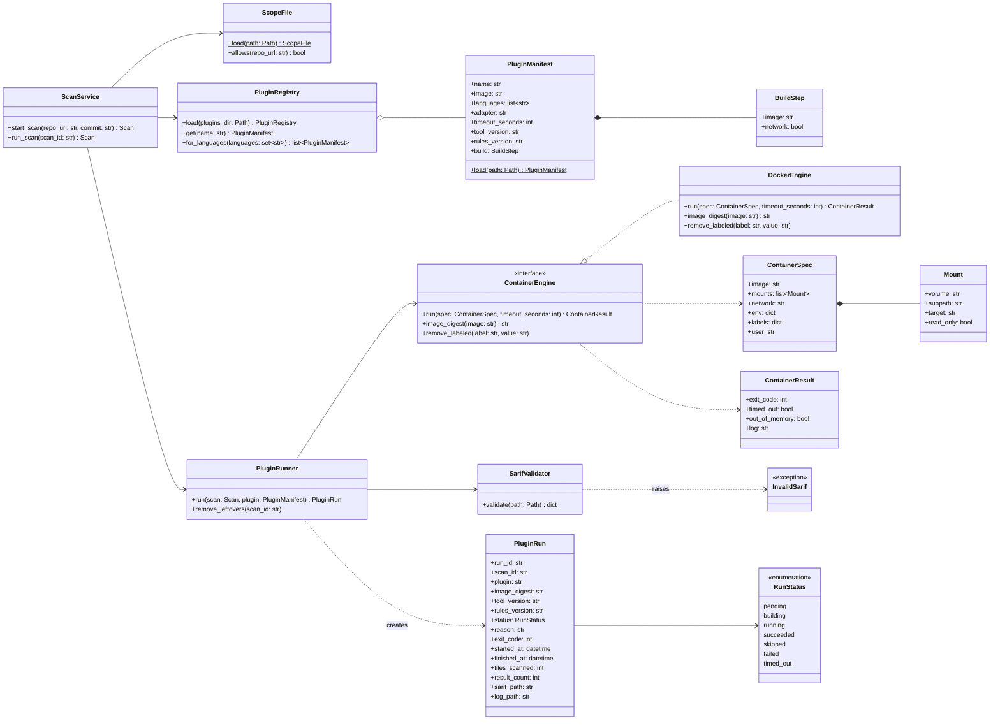
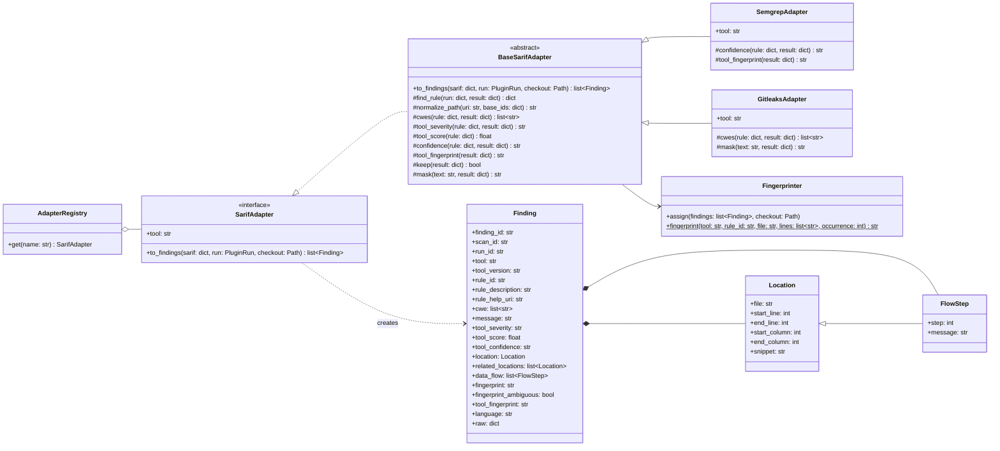
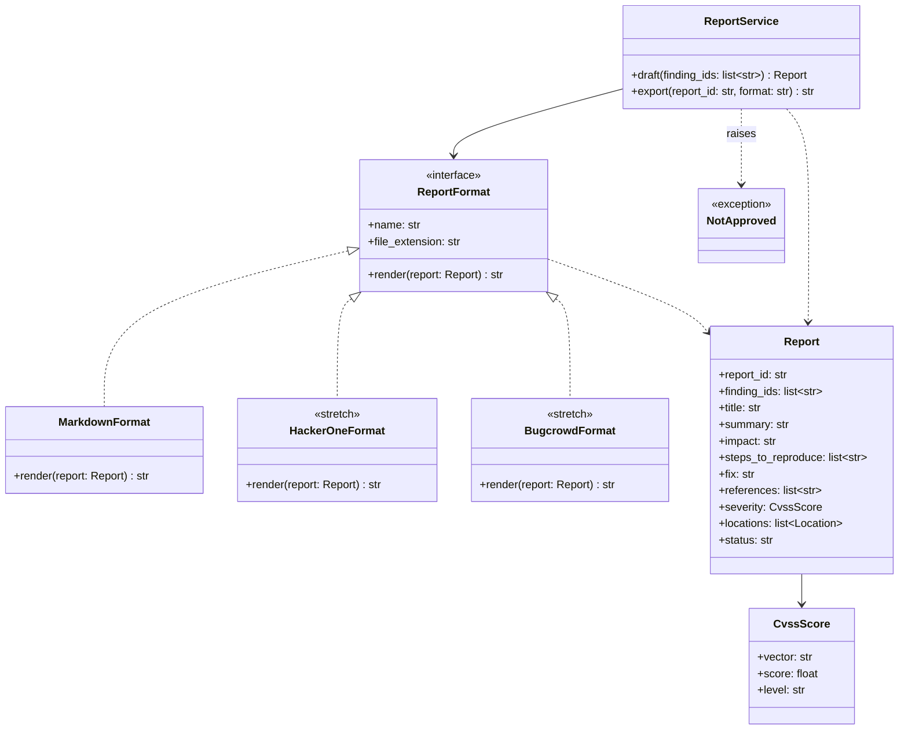

# Class diagrams

Four interfaces let us add an analyzer, a model provider or a report format without changing the core (requirement N5). Each diagram shows the interface and at least one implementation.

## Plug-in and SARIF adapter

Two interfaces keep the analyzers out of the core. A plug-in is a Docker image described by its manifest (`PluginManifest`), and `PluginRunner` runs any plug-in the same way, through the plug-in contract in docs/interfaces.md. A `SarifAdapter` turns one tool's SARIF file into findings in the format of docs/finding-format.md. Adding an analyzer means adding a plug-in directory and one adapter class.

### Plug-in

How `ScanService.run_scan()` works:

1. `start_scan()` checks the repository against the scope file with `ScopeFile.allows()` before anything else, and refuses the scan if the repository isn't listed (requirement F2). Otherwise it creates the scan and puts a job in the queue, and the worker calls `run_scan()`.
2. `run_scan()` clones the commit, exports its files into `sieve-data` without the .git folder, finds the languages in the checkout, and asks `PluginRegistry.for_languages()` for the plug-ins to run.
3. For each plug-in, `PluginRunner.run()` builds `ContainerSpec` objects with the fixed flags from docs/interfaces.md. For a plug-in with a build step it runs the build container first, then the scan container, both within one time limit. `ContainerEngine.run()` waits until the container exits or the limit passes, saves its log, and removes the container in both cases.
4. `PluginRunner` maps the result to a status: the exit code, `timed_out` and `out_of_memory` from `ContainerResult`, and `SarifValidator.validate()`, which raises `InvalidSarif` when the file is missing, isn't SARIF 2.1.0, fails the schema, or is too large. A run whose `scan-info.json` reports 0 scanned files fails as `nothing_scanned` when the checkout has files in the plug-in's languages. It records the image digest and the versions in the `PluginRun`.
5. For each succeeded run, `ScanService` passes the SARIF file to the plug-in's adapter (below) and stores the findings. A failed run doesn't stop the others.

`ContainerEngine` is an interface so that the runner's tests can use a fake engine without Docker, and so that Podman could be added later. `DockerEngine` uses the Docker SDK for Python. `remove_leftovers()` removes containers labeled with a scan's ID, for scans that were running when the worker stopped.

### SARIF adapter

`BaseSarifAdapter` does the mapping that is the same for every tool, as described in docs/finding-format.md: it finds each result's rule, keeps only results that `keep()` accepts, normalizes paths, reads CWEs from tags, relationships and taxa, applies the default level, maps locations and code flows, and has `Fingerprinter` compute the fingerprints for all findings of the run at once, since the occurrence numbers and the `fingerprint_ambiguous` flags depend on the other findings. A tool's adapter overrides only what its tool does differently:

- `SemgrepAdapter.confidence()` reads the `HIGH CONFIDENCE`, `MEDIUM CONFIDENCE` and `LOW CONFIDENCE` rule tags, and `tool_fingerprint()` returns nothing, because Semgrep OSS writes `requires login` instead of a fingerprint.
- `GitleaksAdapter.cwes()` returns `CWE-798`, because Gitleaks gives no CWEs, and `mask()` replaces the secret's columns with `REDACTED` before the text is hashed or stored. In other adapters `mask()` returns the text unchanged.

The Bandit, ESLint and SpotBugs adapters (T2.2) follow the same pattern. Each adapter is tested against a saved SARIF file from a real run of its tool (requirement F1). `to_findings()` fills `finding_id` only when the findings store saves the finding.

## LLM provider

Every LLM call goes through `LLMClient`. It renders the prompt template, answers a repeated request from the cache, checks the run's budget, calls the provider and logs the call. A provider only knows how to send one request to one API, so adding a provider means writing one class.

```mermaid
classDiagram
  direction LR
  class LLMProvider {
    <<interface>>
    +name: str
    +complete(request: LLMRequest) LLMResponse
    +price(model: str) Price
  }
  class AnthropicProvider {
    +complete(request: LLMRequest) LLMResponse
    +price(model: str) Price
  }
  class OpenAIProvider {
    +complete(request: LLMRequest) LLMResponse
    +price(model: str) Price
  }
  class LLMClient {
    +ask(template: PromptTemplate, values: dict, code: list~CodeBlock~, model: str) LLMResponse
  }
  class PromptTemplate {
    +name: str
    +version: str
    +text: str
    +render(values: dict, code: list~CodeBlock~) list~Message~
  }
  class CodeBlock {
    +path: str
    +start_line: int
    +end_line: int
    +text: str
  }
  class LLMRequest {
    +model: str
    +messages: list~Message~
    +temperature: float
    +max_tokens: int
  }
  class LLMResponse {
    +text: str
    +model_version: str
    +input_tokens: int
    +output_tokens: int
    +cost_usd: float
    +duration_ms: int
    +cached: bool
  }
  class Price {
    +input_usd_per_million: float
    +output_usd_per_million: float
  }
  class ResponseCache {
    +get(key: str) LLMResponse
    +put(key: str, response: LLMResponse)
  }
  class Budget {
    +limit_usd: float
    +spent_usd: float
    +reserve(estimate_usd: float)
    +charge(cost_usd: float)
  }
  class CallLog {
    +record(run_id: str, request: LLMRequest, response: LLMResponse) str
  }
  class BudgetExceeded {
    <<exception>>
  }

  LLMProvider <|.. AnthropicProvider
  LLMProvider <|.. OpenAIProvider
  LLMClient --> LLMProvider
  LLMClient --> ResponseCache
  LLMClient --> Budget
  LLMClient --> CallLog
  LLMClient ..> PromptTemplate
  PromptTemplate ..> CodeBlock
  LLMClient ..> LLMRequest
  LLMProvider ..> LLMResponse
  LLMProvider ..> Price
  Budget ..> BudgetExceeded : raises
```

How `ask()` works:

1. `PromptTemplate.render()` builds the messages. Code goes only into the template's marked data block, never into the instructions (requirement N4).
2. The cache key is a hash of the model, the rendered messages, the temperature, `max_tokens` and the template version. On a hit, `ask()` returns the cached response with `cached` set, and nothing is charged.
3. Before the call, `Budget.reserve()` checks the worst case: the input tokens at the input price plus `max_tokens` at the output price. If that doesn't fit in what is left, it raises `BudgetExceeded` and no request is sent. So a run never goes over its limit (requirement N1).
4. After the call, `Budget.charge()` records the actual cost, and `CallLog.record()` stores the request, the response, the exact model version, the tokens and the cost in the LLM calls table, and returns the call ID that verdicts link to (requirement N3).

Temperature is 0 wherever the API allows it. API keys are read from environment variables by each provider. `LLMClient` doesn't choose between models: the triage agent asks the cheaper model first and the stronger one only when the first is unsure.

## Report format

A report format turns a `Report` into the text of one exported file. Markdown is the core format, and the platform formats are stretch goals (T4.2). The fields of `Report` follow the report schema in docs/interfaces.md.

`ReportService.export()` checks that every finding in the report is approved and raises `NotApproved` otherwise, so nothing leaves Sieve without a person's approval (requirement F5). `draft()` writes the text through `LLMClient`, and the reviewer can edit any field before export. HackerOne's format maps the severity to its CVSS-based rating, and Bugcrowd's maps it to a VRT priority.
