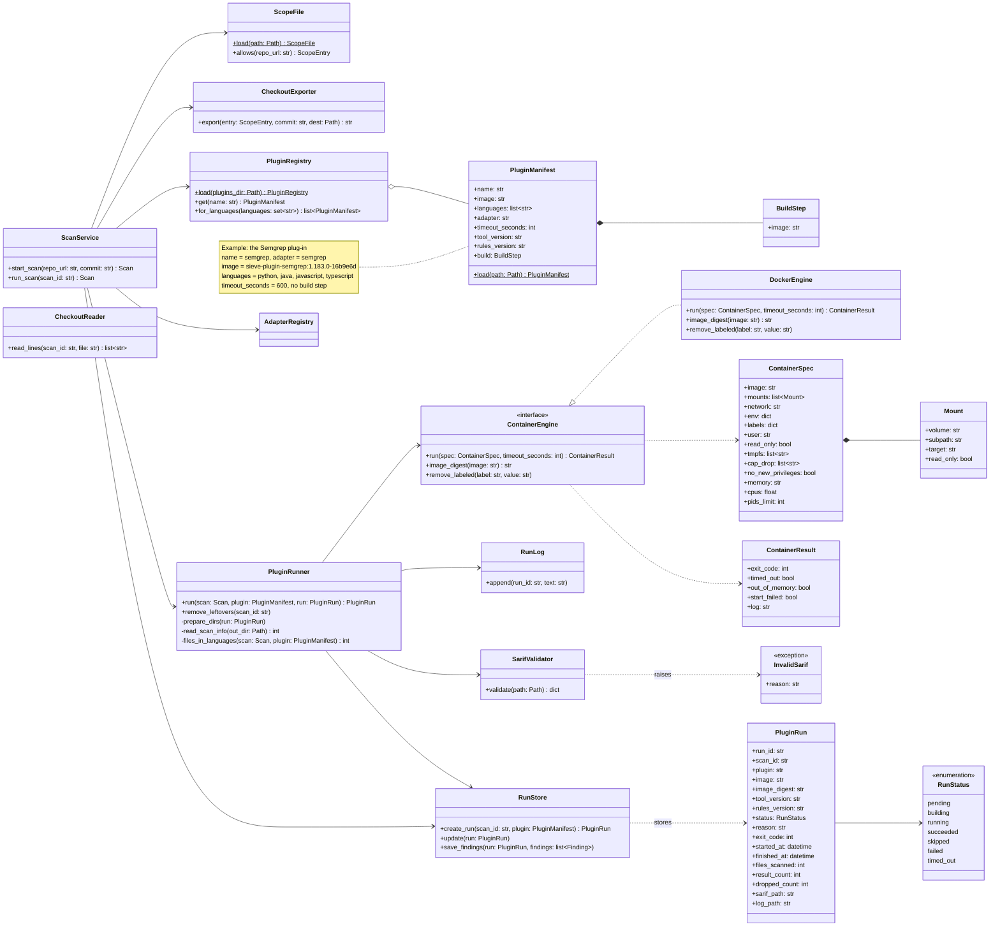
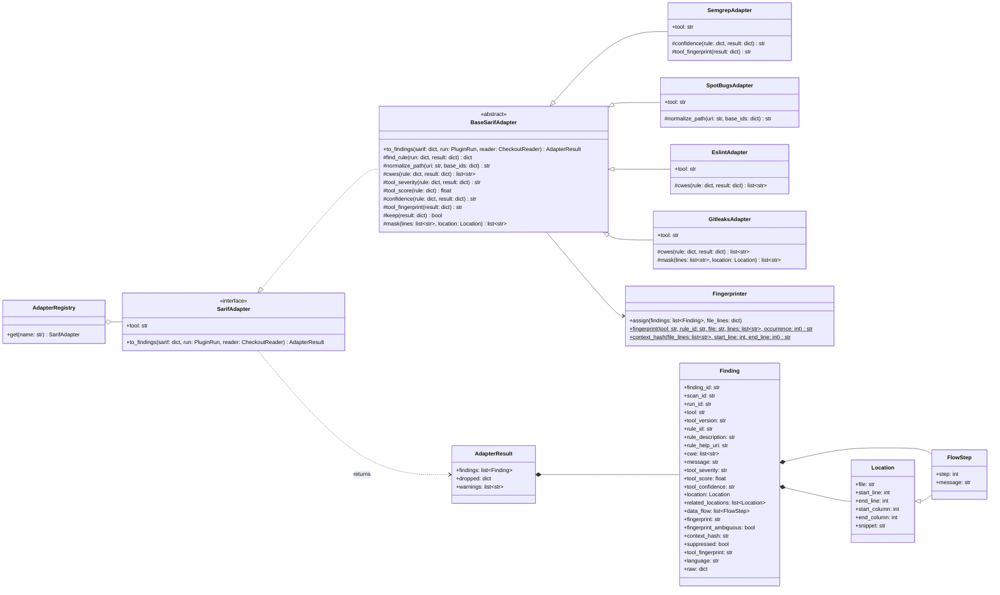
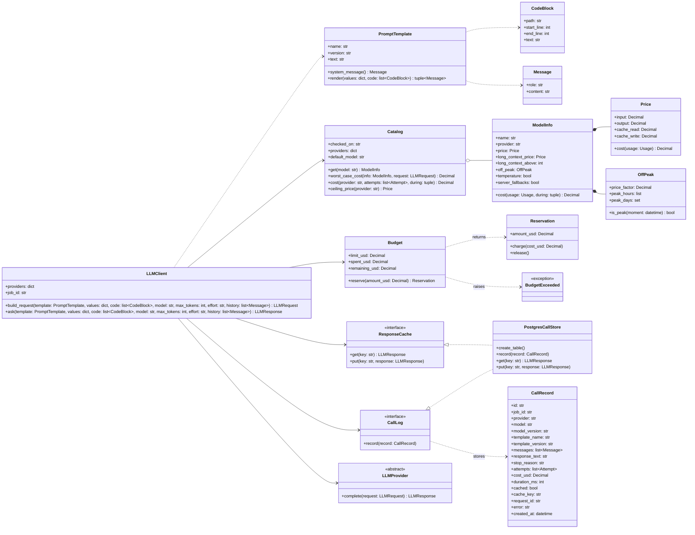
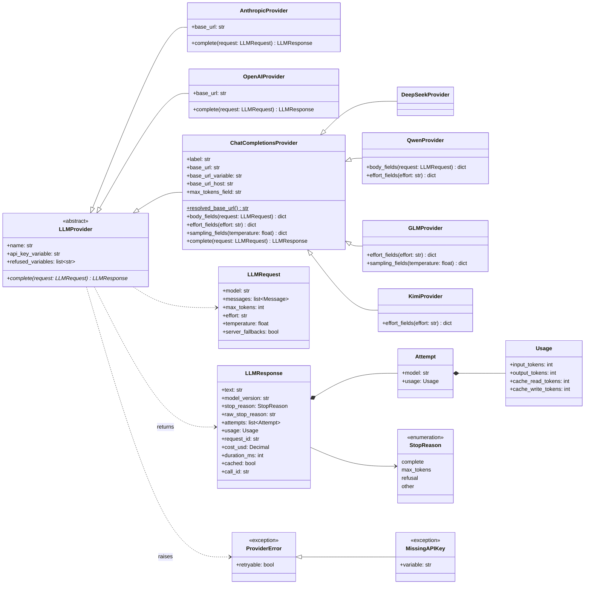
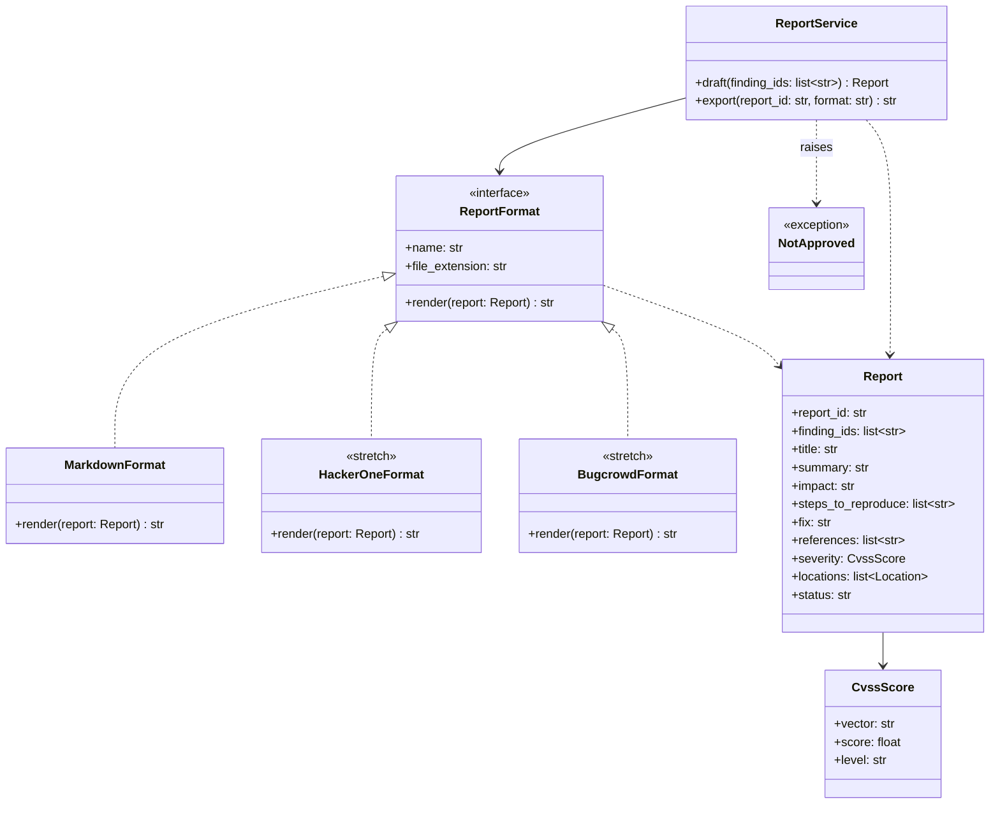

# Class diagrams

Four interfaces let us add an analyzer, a model provider or a report format without changing the core (requirement N5). Each diagram shows the interface and at least one implementation.

## Plug-in and SARIF adapter

Two interfaces keep the analyzers out of the core. A plug-in is a Docker image described by its manifest (`PluginManifest`), and `PluginRunner` runs any plug-in the same way, through the plug-in contract in docs/interfaces.md. A `SarifAdapter` turns one tool's SARIF file into findings in the format of docs/finding-format.md. Adding an analyzer means adding a plug-in directory and one adapter class. The Semgrep plug-in and its adapter are the examples.

### Plug-in

How `ScanService` works:

1. `start_scan()` runs in the API. It checks the repository with `ScopeFile.allows()`, which returns the matching scope entry or refuses the scan before anything else (requirement F2). It then creates the scan and puts a job in the queue, and the worker calls `run_scan()`.
2. `run_scan()` calls `CheckoutExporter.export()`. The exporter clones the URL from the scope entry without credentials, redirects or submodules, refuses a commit that isn't on a branch or tag of that repository, and exports the files into `sieve-data` without the .git folder, symbolic links or the tools' ignore files. It returns the full commit hash, which the scan stores. `run_scan()` then finds the languages in the checkout and asks `PluginRegistry.for_languages()` for the plug-ins to run.
3. For each plug-in, `RunStore.create_run()` stores a `PluginRun` as `pending`, so the run's ID exists before any container starts: the containers' labels and folders use it. `PluginRunner.run()` creates the run's folders and gives them to user 10001, and updates the status through `RunStore.update()` at every change: `building`, `running`, and the end status.
4. The runner builds a `ContainerSpec` with every flag from docs/interfaces.md as a field, for the build container and then the scan container, within one time limit. Because the flags are fields, the runner's tests can check them with a fake engine. `ContainerEngine.run()` waits until the container exits or the limit passes, and removes the container in every case, including when it was created but failed to start. `RunLog` keeps both steps' output in the run's log, up to 5 MB.
5. The runner turns the result into a status and reason. It uses the exit code, `timed_out`, `out_of_memory` and `start_failed` from `ContainerResult`; `SarifValidator.validate()`, whose `InvalidSarif` carries the reason `missing_sarif` or `invalid_sarif`; and `read_scan_info()` with `files_in_languages()` for `nothing_scanned`. It records the image digest and the versions in the `PluginRun`.
6. For each succeeded run, `ScanService` passes the SARIF file to the plug-in's adapter (below), and `RunStore.save_findings()` stores all of the run's findings in one transaction, together with the run's result and dropped counts. The adapter's warnings go to `RunLog`. A failed run doesn't stop the others.

`ContainerEngine` is an interface so that the runner's tests can use a fake engine without Docker, and so that Podman could be added later. `DockerEngine` uses the Docker SDK for Python, version 7.2.0 or later. `remove_leftovers()` removes containers labeled with a scan's ID, for scans that were running when the worker stopped.

`CheckoutReader` is the one way to read a checkout. It resolves every path and refuses any that leaves the checkout. The adapters use it, and so can the triage agent's context collector and tools, so that no read can follow a path out of the checkout.

### SARIF adapter

`BaseSarifAdapter` does the mapping that is the same for every tool, as described in docs/finding-format.md: it finds each result's rule, keeps only results that `keep()` accepts, normalizes paths, reads CWEs from tags, relationships and taxa, applies the default level, marks suppressed results, maps locations and code flows, and takes `tool_version` from the plug-in run. It reads each flagged file once through `CheckoutReader`, applies `mask()`, and passes the masked lines of all files to `Fingerprinter.assign()`. The fingerprinter computes the fingerprints, the context hashes and the `fingerprint_ambiguous` flags for all findings of the run at once, since the occurrence numbers depend on the other findings. Because it only gets lines that `mask()` has already handled, no secret that an adapter masks can reach a hash.

`to_findings()` returns an `AdapterResult` with the findings, the number of results dropped for each reason, and the warnings for the run's log. It fills `finding_id` only when the findings store saves the finding.

A tool's adapter overrides only what its tool does differently:

- `SemgrepAdapter.confidence()` reads the `HIGH CONFIDENCE`, `MEDIUM CONFIDENCE` and `LOW CONFIDENCE` rule tags, and `tool_fingerprint()` returns nothing, because Semgrep without a login writes `requires login` instead of a fingerprint.
- `SpotBugsAdapter.normalize_path()` also tries the source folders the Java build step listed, because SpotBugs writes paths relative to a source folder when it doesn't know the folder.
- `EslintAdapter.cwes()` maps the rules of eslint-plugin-security to CWEs with the table in docs/finding-format.md, because the plug-in gives none.
- `GitleaksAdapter.cwes()` returns `CWE-798`, and `mask()` replaces every flagged line with `REDACTED`. In other adapters `mask()` returns the lines unchanged.

The Bandit adapter (T2.2) follows the same pattern. Each adapter is tested against a saved SARIF file from a real run of its tool (requirement F1).

## LLM provider

Every LLM call goes through `LLMClient`. It renders the prompt template, answers a repeated request from the cache, checks the run's budget, calls the provider, prices the answer and logs the call. A provider only knows how to send one request to one API, so adding a provider means writing one class and adding its models to `backend/app/llm/models.json`. docs/llm-provider.md has the details.

### Client

How `ask()` works:

1. `build_request()` takes the model from the `Catalog`, or its `default_model` when the call names none. `PromptTemplate.render()` gives a system message with the template text and the rules for data, and a user message made by `data_block()`: one JSON object with the values and each `CodeBlock`'s path, lines and text, between markers whose id is a hash of the content. Code never goes into the instructions (requirement N4). Earlier turns in `history` have to be the model's answers or blocks made by `data_block()`.
2. The cache key is a hash of the model, the messages, `max_tokens`, the effort, the temperature and the fallback setting. On a hit, `ask()` returns the cached response with `cached` set, and logs it at no cost.
3. Before the call, `Budget.reserve()` sets aside `Catalog.worst_case_cost()`: every byte of the prompt counted as a token at the model's highest input price, and `max_tokens` at its output price, with a second attempt added when Claude's refusal fallbacks are on. If that doesn't fit in what is left, it raises `BudgetExceeded` and nothing is sent (requirement N1).
4. The provider sends the request. `Catalog.cost()` prices each `Attempt` at its own model's price, with the long-context or off-peak price where models.json has one, and `Reservation.charge()` replaces the reservation with that cost. A failed call releases its reservation.
5. `CallLog.record()` stores a `CallRecord` with the prompt, the response, the exact model version, the attempts with their tokens, the cost and the duration in the llm_calls table. Its id comes back as `call_id`, which verdicts link to (requirement N3). If the write fails, the record goes to the error log, and the answer is still returned.

`PostgresCallStore` is both the call log and the cache: `get()` returns the latest complete answer with the same key from llm_calls. The tests use `InMemoryCallLog` and `InMemoryResponseCache` instead.

### Providers

`providers_from_env()` imports each class listed under `providers` in models.json and sets it up when its key variable is set. A provider reads its key only from the environment, passes its API's base URL to the SDK, and refuses to start while one of its `refused_variables` is set, because the SDK would add that to every request. It turns the SDK's errors into `ProviderError`, whose `retryable` says whether trying again later can help.

DeepSeek, Qwen, GLM and Kimi serve OpenAI's Chat Completions format, so they extend `ChatCompletionsProvider` and override only how their API takes the output limit, the effort and the temperature. `QwenProvider.body_fields()` splits `max_tokens` between thinking and answer, because Qwen's own `max_tokens` leaves out the thinking. `GLMProvider.sampling_fields()` sends `do_sample: false` instead of a temperature of 0, and `KimiProvider` sends `max_completion_tokens`. Each `Attempt` in a response is one model run with its own tokens: a Claude refusal fallback adds a second one, charged at its own model's price.

Temperature 0 goes only to models that accept it, as marked in models.json. `LLMClient` doesn't choose between models: a call that names none goes to `default_model`, deepseek-flash, and the triage agent asks the cheaper model first and the stronger one only when the first is unsure.

## Report format

A report format turns a `Report` into the text of one exported file. Markdown is the core format, and the platform formats are stretch goals (T4.2). The fields of `Report` follow the report schema in docs/interfaces.md.

`ReportService.export()` checks that every finding in the report is approved and raises `NotApproved` otherwise, so nothing leaves Sieve without a person's approval (requirement F5). `draft()` writes the text through `LLMClient`, and the reviewer can edit any field before export. HackerOne's format maps the severity to its CVSS-based rating, and Bugcrowd's maps it to a VRT priority.
