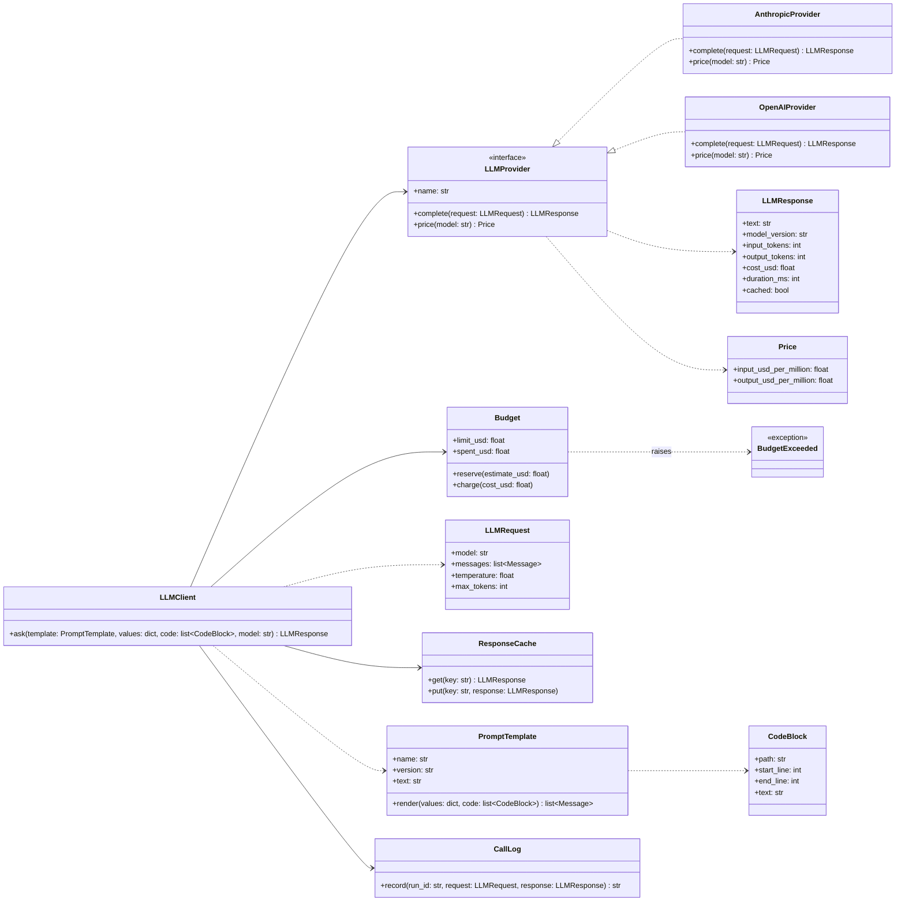
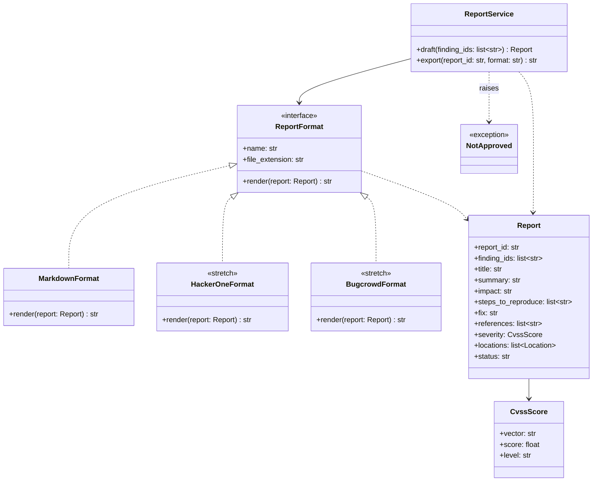

# Class diagrams

Four interfaces let us add an analyzer, a model provider or a report format without changing the core (requirement N5). Each diagram shows the interface and at least one implementation.

## Plug-in and SARIF adapter

To be written by Ali.

## LLM provider

Every LLM call goes through `LLMClient`. It renders the prompt template, answers a repeated request from the cache, checks the run's budget, calls the provider and logs the call. A provider only knows how to send one request to one API, so adding a provider means writing one class.

How `ask()` works:

1. `PromptTemplate.render()` builds the messages. Code goes only into the template's marked data block, never into the instructions (requirement N4).
2. The cache key is a hash of the model, the rendered messages, the temperature, `max_tokens` and the template version. On a hit, `ask()` returns the cached response with `cached` set, and nothing is charged.
3. Before the call, `Budget.reserve()` checks the worst case: the input tokens at the input price plus `max_tokens` at the output price. If that doesn't fit in what is left, it raises `BudgetExceeded` and no request is sent. So a run never goes over its limit (requirement N1).
4. After the call, `Budget.charge()` records the actual cost, and `CallLog.record()` stores the request, the response, the exact model version, the tokens and the cost in the LLM calls table, and returns the call ID that verdicts link to (requirement N3).

Temperature is 0 wherever the API allows it. API keys are read from environment variables by each provider. `LLMClient` doesn't choose between models: the triage agent asks the cheaper model first and the stronger one only when the first is unsure.

## Report format

A report format turns a `Report` into the text of one exported file. Markdown is the core format, and the platform formats are stretch goals (T4.2). The fields of `Report` follow the report schema in docs/interfaces.md.

`ReportService.export()` checks that every finding in the report is approved and raises `NotApproved` otherwise, so nothing leaves Sieve without a person's approval (requirement F5). `draft()` writes the text through `LLMClient`, and the reviewer can edit any field before export. HackerOne's format maps the severity to its CVSS-based rating, and Bugcrowd's maps it to a VRT priority.
