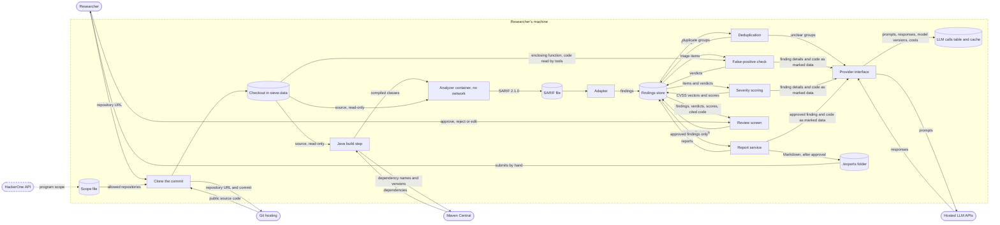

# Data flow

This document shows how a finding moves from an analyzer's SARIF output to an exported report, and exactly which data leaves the researcher's machine. It is the basis for requirement N4: only public code goes to outside APIs, code is passed to the LLM as marked data, and API keys stay out of the repository.

## Diagram

Rectangles are processes, cylinders are data stores, and rounded boxes are people and outside services. The dashed box is the boundary of the researcher's machine: every arrow that crosses it to an outside service is listed in the next section. The researcher sits at the machine, so the arrows to and from the researcher are not network traffic. Dashed arrows are stretch goals.

## Data that crosses the machine boundary

| Data | Direction | Between | When | What it contains | Limits |
|---|---|---|---|---|---|
| Clone request | out | worker to Git hosting | once per scan | the repository URL and commit | only repositories in the scope file (F2), cloned without credentials, so only public repositories work |
| Source code | in | Git hosting to worker | once per scan | the repository at that commit | read-only for the analyzers |
| Dependency requests | out | Java build container to Maven Central | Java builds only | the names and versions of the dependencies in the project's pom.xml | the build container's own network, with nothing else on it |
| Dependencies | in | Maven Central to Java build container | Java builds only | JAR files | kept in the `m2-cache` volume |
| Prompts for deduplication | out | provider interface to the LLM API | only for groups the rules and text similarity can't decide | for each finding in the group: tool, rule, CWEs, message, file path, line numbers and the flagged code | code only in the marked data block |
| Prompts for the false-positive check | out | provider interface to the LLM API | once per triage item, plus a second call to the stronger model when the first is unsure | the finding details above, the enclosing function, the data-flow path when there is one, and the code the agent reads with its tools, at most 5 tool calls per item | code only in the marked data block |
| Prompts for severity scoring | out | provider interface to the LLM API | once per triage item | the finding details, the verdict and reasoning, and the cited code | code only in the marked data block |
| Prompts for report drafts | out | provider interface to the LLM API | once per approved finding | the approved finding, its verdict, severity and cited code, and the reviewer's edits | only after approval |
| LLM responses | in | LLM API to provider interface | for every prompt | the model's text and token counts | stored in the LLM calls table with the prompt (N3) |
| API key | out | provider interface to the LLM API | with every request | the key, in the request's authentication header over HTTPS | only to the provider the key belongs to |
| Program scope (stretch) | in | HackerOne API to Sieve | when the researcher imports a program's scope | the program's assets and whether each is in scope | stretch goal S3 |

Prompts carry no repository name or URL and no CVE IDs or CVE descriptions, so the model judges the code and not what it may remember about the project. In the evaluation, benchmark files and test names are also renamed before triage, as planned in the proposal's risk analysis.

## What stays on the machine

- The findings store: findings, duplicate groups, verdicts, reviews, reports and the LLM call log. The database is only on the Compose project's internal network and has no published port.
- The scope file and review decisions.
- Exported reports. They are written to the `./exports` folder, and the researcher submits them by hand. Sieve never sends a report to a bug bounty platform. Submission is tested only against the mock server (S4), which runs on the machine.
- API keys. They are read from environment variables that come from an `.env` file that Git ignores. Only the worker container gets them. They are never written into a prompt, the database, a log or a report, and Gitleaks checks every pull request for keys committed by mistake (N4).
- Secrets found by Gitleaks. Gitleaks runs with `--redact`, so the secret value never reaches the SARIF file. The adapter replaces the secret's columns with `REDACTED` before it stores a snippet or computes a fingerprint, and the triage agent's context collector does the same before it puts the code of a Gitleaks finding into a prompt.

## Guarantees and where they are enforced

| Guarantee | Enforced by | Tested in |
|---|---|---|
| Only public code reaches the LLM APIs | the scope file check before cloning, and cloning without credentials (F2) | T2.4 |
| Code is passed as data, never as instructions | the prompt templates, which put code only inside the marked data block (docs/class-diagrams.md) | T3.1 |
| Every request to an LLM goes through one place | the provider interface is the only code that holds the API keys and calls the APIs | T3.1 |
| Analyzers can't send anything out | `--network none` on every analyzer container. Only the Java build step has network, through its own network (docs/interfaces.md). | T2.1 |
| Nothing is exported before approval | the report service checks every finding's latest review before it writes a file (F5) | T5.2 |
| API keys never reach the repository | `.env` is in `.gitignore`, and Gitleaks scans the full history in CI | T1.3 |

One limit: the code sent to the LLM is the public code of the scanned repository, and it can itself contain secrets that its authors committed. Those are already public in the repository, so sending them adds no new exposure, but the review screen shows the code as it is, without hiding anything.
