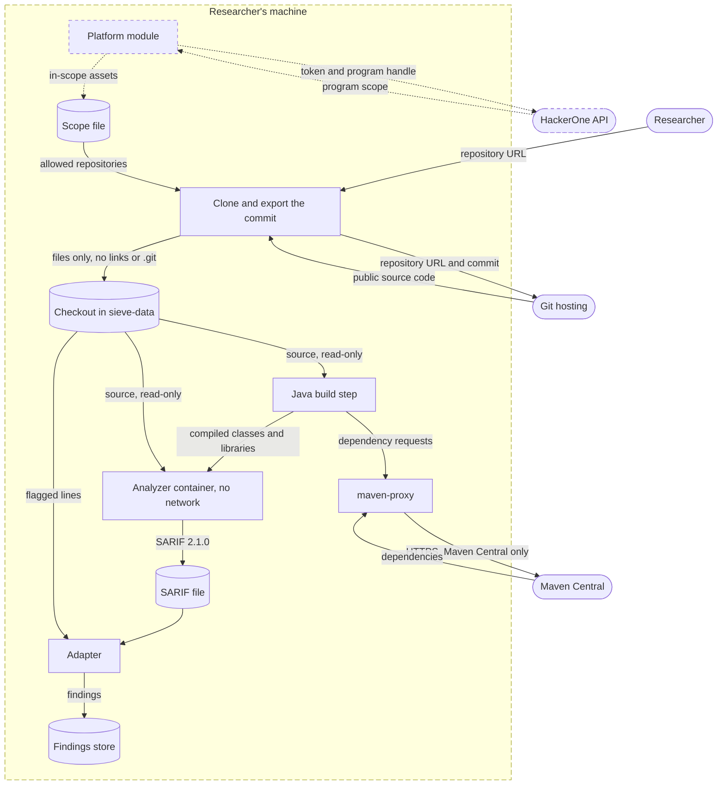
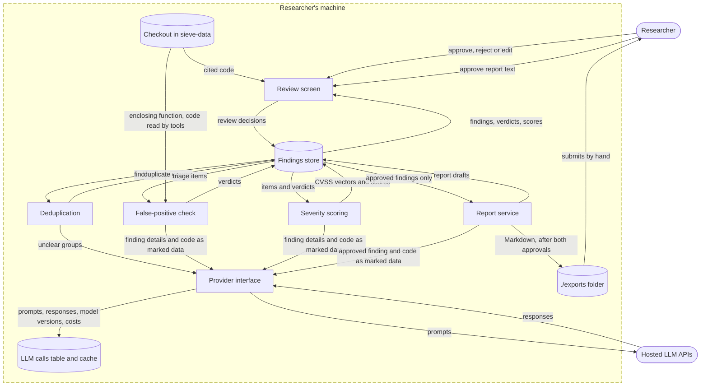

# Data flow

This document shows how a finding moves from an analyzer's SARIF output to an exported report, and exactly which data leaves the researcher's machine. It is the basis for requirement N4: only public code goes to outside APIs, code is passed to the LLM as marked data, and API keys stay out of the repository.

## Diagram

Rectangles are processes, cylinders are data stores, and rounded boxes are people and outside services. The dashed box is the boundary of the researcher's machine: every arrow that crosses it to an outside service is listed in the next section. The researcher sits at the machine, so the arrows to and from the researcher are not network traffic. Dashed arrows are stretch goals.

The flow is split in two. The checkout and the findings store appear in both halves.

### From the repository to findings

### From findings to reports

## Data that crosses the machine boundary

During a scan and its triage:

| Data | Direction | Between | When | What it contains | Limits |
|---|---|---|---|---|---|
| Clone request | out | worker to Git hosting | once per scan | the repository URL and commit | only repositories in the scope file, cloned from the URL in the scope file, without credentials, redirects or submodules, so only public repositories work (F2) |
| Source code | in | Git hosting to worker | once per scan | the repository at that commit | exported without symbolic links, the .git folder or the tools' ignore files (docs/interfaces.md) |
| Requests from the Java build | out | Java build container to Maven Central, through `maven-proxy` | Java builds only | whatever the build sends. Maven sends the names and versions of the dependencies, but the build also runs code from the scanned project, such as Maven plug-ins named in its pom.xml, and that code can send any data it chooses, including the public source it was given. | only to Maven Central: the build container is on an internal network, and the proxy allows no other host |
| Dependencies | in | Maven Central to Java build container | Java builds only | JAR files | kept in the repository's own Maven cache volume |
| Prompts for deduplication | out | provider interface to the LLM API | only for groups the rules and text similarity can't decide | for each finding in the group: tool, rule, CWEs, message, file path, line numbers and the flagged code | code only in the marked data block |
| Prompts for the false-positive check | out | provider interface to the LLM API | once per triage item, plus a second call to the stronger model when the first is unsure | the finding details above, the enclosing function, the data-flow path when there is one, and the code the agent reads with its tools, at most 5 tool calls per item | code only in the marked data block |
| Prompts for severity scoring | out | provider interface to the LLM API | once per triage item | the finding details, the verdict and reasoning, and the cited code | code only in the marked data block |
| Prompts for report drafts | out | provider interface to the LLM API | once per approved finding, and again for each new draft | the approved finding, its verdict, severity and cited code, and the reviewer's edits | only after the finding is approved |
| LLM responses | in | LLM API to provider interface | for every prompt | the model's text and token counts | stored in the LLM calls table with the prompt (N3) |
| LLM API key | out | provider interface to the LLM API | with every request | the key, in the request's authentication header over HTTPS | only to the provider the key belongs to, never in the request's content |
| HackerOne request (stretch) | out | platform module to the HackerOne API | when the researcher imports a program's scope | the researcher's HackerOne API name and token, in the authentication header, and the program's handle | stretch goal S3 |
| Program scope (stretch) | in | HackerOne API to the platform module | the same | the program's assets and whether each is in scope | stretch goal S3 |

The LLM providers can keep prompts and responses for a while under their API terms, for example for abuse monitoring. That is one more reason Sieve sends only public code.

When Sieve is installed or updated, never during a scan:

| Data | Direction | Between | What it contains |
|---|---|---|---|
| Image and package downloads | out and in | Docker and the image builds to Docker Hub, GitHub, PyPI, npm and Maven Central | requests for the pinned base images, the semgrep-rules repository, and the Python, JavaScript and Java packages the images install. No code or findings from a scan. |

Prompts carry no repository name or URL and no CVE IDs or CVE descriptions, so the model judges the code and not what it may remember about the project. File paths, package names and the code itself can still identify a well-known project such as WebGoat, which is why the evaluation also renames benchmark files and test names before triage, as planned in the proposal's risk analysis.

## What stays on the machine

- The findings store: findings, duplicate groups, verdicts, reviews, reports and the LLM call log. The database is only on the Compose project's internal network and has no published port.
- The scope file and review decisions.
- Exported reports. They are written to the `./exports` folder, and the researcher submits them by hand. Sieve has no code that submits to a real bug bounty platform. The stretch submission client (S4) is built and tested only against the mock server, which runs on the machine.
- API keys and tokens, as content. The LLM API keys and the HackerOne token are read from environment variables that come from an `.env` file that Git ignores, and only the worker container gets them. They leave the machine only as the authentication header of requests to their own service, as the table above shows. They are never written into a prompt, the database, a log or a report, and Gitleaks checks every pull request for keys committed by mistake (N4).

## Guarantees and where they are enforced

| Guarantee | Enforced by | Tested in |
|---|---|---|
| Only public code reaches the LLM APIs | the scope check before cloning, cloning the scope file's URL without credentials, and refusing commits that aren't on a branch or tag of the listed repository (F2) | T2.4 |
| API keys never reach a prompt | the keys exist only in the worker's environment. The export drops symbolic links, so no file in the checkout can point to the worker's environment, and every read of the checkout goes through one reader that refuses paths that leave it (docs/class-diagrams.md). | T2.1, with a planted link to `/proc/self/environ` |
| Code is passed as data, never as instructions | the prompt templates, which put code only inside the marked data block (docs/class-diagrams.md) | T3.1 |
| Every request to an LLM goes through one place | the provider interface is the only code that holds the API keys and calls the APIs | T3.1 |
| Analyzers can't send anything out | `--network none` on every analyzer container. Only the Java build step has network, and it reaches only Maven Central (docs/interfaces.md). | T2.1 |
| Scanned code can't hide its own findings | the plug-ins turn off in-source suppression, the export drops the tools' ignore files, and the adapters keep suppressed results (docs/interfaces.md) | T2.2 |
| Nothing is exported before approval | the report service checks the finding's latest review and the approval of the report's current text before it writes a file (F5). The API requires a token, and no container that Sieve starts can reach it. | T5.2 |
| API keys never reach the repository | `.env` is in `.gitignore`, and Gitleaks scans the full history in CI | T1.3 |

## Secrets in the scanned code

The scanned repositories are public, so any secret their authors committed is already public. Sieve doesn't promise to keep such secrets away from the LLM, and it can't: other tools flag the same lines, such as Semgrep's rules for hard-coded keys, and the triage agent reads the code around a finding.

What Sieve does is narrower:

- Gitleaks runs with `--redact`, so its SARIF file doesn't contain the secret values.
- The Gitleaks adapter replaces every line that Gitleaks flagged with `REDACTED` before it stores the snippet or computes the fingerprint (docs/finding-format.md). The Gitleaks finding itself never stores the secret.
- The review screen shows the code as it is, without hiding anything.
