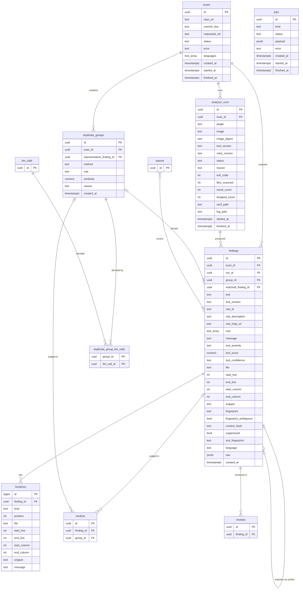

# Database

Sieve keeps its data in one PostgreSQL database, the findings store. This document describes its tables: the scan side (scans, analyzer runs, findings, locations and duplicate groups) and the review side (verdicts, reviews, reports and LLM calls). The findings store and API (T2.3) and the LLM call log (T3.1) create these tables.

## ER diagram

The scan side is complete. The review-side tables show only their keys and their links to the scan side, and Furkan adds their columns and the links between them.

`text_array` stands for PostgreSQL's `text[]`, and `bool` for `boolean`, because Mermaid can't show those names. The two keys of `duplicate_group_llm_calls` together form its primary key, and each is also a foreign key.

## Conventions

- Primary keys are UUIDs made by PostgreSQL with `gen_random_uuid()`, except `locations`, which has many small rows and uses a `bigint` identity.
- Values from a fixed list, such as statuses, are `text` with a `CHECK` constraint. Adding a value then needs only a new constraint, not a new PostgreSQL enum type.
- Times are `timestamptz`, stored in UTC.
- Deleting a finding deletes its locations. Every other foreign key blocks the delete, because reviews and verdicts must never lose the finding they refer to (requirement N3). We don't delete scans in normal use.

## Scan side

### scans

One row per scan of one commit of one repository.

| Column | Type | Can be empty | Meaning |
|---|---|---|---|
| `id` | uuid | no | primary key |
| `repo_url` | text | no | the repository URL, normalized as in the scope file check (requirement F2) |
| `commit_sha` | text | yes | the full 40-character commit hash that was scanned. Empty until the worker has cloned the repository, because the API can't resolve a branch, tag or short hash without going online. |
| `requested_ref` | text | yes | what the researcher asked for, if it wasn't a full commit hash: a branch, a tag or a short hash |
| `status` | text | no | `queued` when created, `running` once the worker starts it, then `completed`, `partial` or `failed` by the rules in docs/interfaces.md |
| `error` | text | yes | why the scan failed, for example a clone error or a commit that isn't on a branch or tag of the repository |
| `languages` | text[] | no | the languages found in the checkout, which decide the plug-ins to run. Empty until the checkout is done. |
| `created_at` | timestamptz | no | when the scan was requested |
| `started_at` | timestamptz | yes | when the worker started it |
| `finished_at` | timestamptz | yes | when its last plug-in run ended |

A check constraint requires `commit_sha` or `requested_ref` to be filled. A scan that the scope check refuses is never created, so every row here is a repository from the scope file.

### analyzer_runs

One row per plug-in run in a scan. This table is not one of the eight in the proposal, but the plug-in contract needs it: it records the tool and rules versions of every scan (requirement F1) and why a run failed. The `PluginRun` class in docs/class-diagrams.md maps to it.

| Column | Type | Can be empty | Meaning |
|---|---|---|---|
| `id` | uuid | no | primary key, the `run_id` of findings |
| `scan_id` | uuid | no | the scan, references `scans` |
| `plugin` | text | no | the plug-in's name from its manifest, such as `semgrep` |
| `image` | text | no | the image name and tag from the manifest |
| `image_digest` | text | yes | the digest of the image that ran. Empty when the image couldn't be found, which ends the run as `runner_error`. |
| `tool_version` | text | no | from the manifest |
| `rules_version` | text | no | from the manifest |
| `status` | text | no | `pending`, `building`, `running`, `succeeded`, `skipped`, `failed` or `timed_out` |
| `reason` | text | yes | for failed runs: `exit_code`, `missing_sarif`, `nothing_scanned`, `invalid_sarif`, `out_of_memory`, `build_failed`, `runner_error` or `interrupted` |
| `exit_code` | integer | yes | the container's exit code, empty while running and after a timeout |
| `files_scanned` | integer | yes | the number of files the tool scanned, from `scan-info.json` |
| `result_count` | integer | yes | the number of results in the SARIF file |
| `dropped_count` | integer | no | results the adapter didn't turn into findings, for the reasons in docs/finding-format.md. Default 0. Written together with the run's findings. |
| `sarif_path` | text | yes | where the SARIF file is in the `sieve-data` volume |
| `log_path` | text | yes | where the run's log is in the `sieve-data` volume |
| `started_at` | timestamptz | yes | |
| `finished_at` | timestamptz | yes | |

Each plug-in runs at most once per scan: `(scan_id, plugin)` is unique. Scanning again means a new scan.

### findings

One row per finding, in the format of docs/finding-format.md. Each field of that format has a column here with the same name, except for these:

- `finding_id` is `id`.
- The primary location is stored in the columns `file`, `start_line`, `end_line`, `start_column`, `end_column` and `snippet`, because almost every query filters or sorts by it. Related locations and data-flow steps are in `locations`.
- `group_id` and `matched_finding_id` are added by deduplication.

| Column | Type | Can be empty | Meaning |
|---|---|---|---|
| `id` | uuid | no | primary key |
| `scan_id` | uuid | no | the scan, references `scans` |
| `run_id` | uuid | no | the plug-in run that produced it, references `analyzer_runs` |
| `group_id` | uuid | yes | its duplicate group, references `duplicate_groups` together with `scan_id`, so a finding can only join a group of its own scan. Empty when the finding has no duplicates, so it is a triage item on its own. |
| `matched_finding_id` | uuid | yes | the latest earlier finding of the same repository with the same fingerprint, references `findings`. Set by deduplication. Whether that match lets the new finding be hidden is decided by the rules in docs/finding-format.md, "When a finding is hidden". |
| `tool` | text | no | the plug-in's name |
| `tool_version` | text | no | from the plug-in run's manifest |
| `rule_id` | text | no | |
| `rule_description` | text | yes | |
| `rule_help_uri` | text | yes | |
| `cwe` | text[] | no | CWE IDs such as `CWE-89`, sorted. Can be an empty array. |
| `message` | text | no | |
| `tool_severity` | text | no | `error`, `warning`, `note` or `none` |
| `tool_score` | numeric(3,1) | yes | from 0.0 to 10.0 |
| `tool_confidence` | text | yes | `high`, `medium` or `low` |
| `file` | text | no | path relative to the repository root |
| `start_line` | integer | no | starts at 1 |
| `end_line` | integer | no | at least `start_line` |
| `start_column` | integer | yes | starts at 1 |
| `end_column` | integer | yes | |
| `snippet` | text | yes | the flagged code. For Gitleaks, the flagged lines replaced by `REDACTED`. |
| `fingerprint` | text | no | computed as in docs/finding-format.md, such as `v1:418dc3c913dc63ec1ee12209f03b55f1` |
| `fingerprint_ambiguous` | boolean | no | true when another finding in the same run has the same rule, file and flagged code |
| `context_hash` | text | no | the hash of the code around the finding, such as `c1:a5b7da088c06eb2371e6939f52ee1e61` |
| `suppressed` | boolean | no | true when the scanned code asked the tool to ignore this result |
| `tool_fingerprint` | text | yes | the tool's own fingerprint, when it is stable |
| `language` | text | yes | `python`, `java`, `javascript`, `typescript`, `html` or `other` |
| `raw` | jsonb | no | the SARIF result the finding came from |
| `created_at` | timestamptz | no | |

`(scan_id, fingerprint)` is unique: the fingerprint includes the tool, and the occurrence number in it keeps two identical results apart. `(id, group_id)` is unique too, so that `duplicate_groups` can check its representative (below).

To decide whether a new finding can be hidden, deduplication looks up the latest review of any earlier finding with the same fingerprint in a scan of the same `repo_url`, not only in the previous scan. So a finding that was hidden in the second scan, and therefore never reviewed there, still counts as reviewed in the third. The lookup uses the `findings (fingerprint)` and `scans (repo_url, created_at)` indexes.

### locations

The related locations and the data-flow steps of a finding. The primary location is in `findings`.

| Column | Type | Can be empty | Meaning |
|---|---|---|---|
| `id` | bigint | no | primary key |
| `finding_id` | uuid | no | the finding, references `findings`. Deleted with the finding. |
| `kind` | text | no | `related` or `flow_step` |
| `position` | integer | no | the order within its kind, starting at 1. For a data-flow step, this is its `step`. |
| `file` | text | no | path relative to the repository root |
| `start_line` | integer | no | |
| `end_line` | integer | no | |
| `start_column` | integer | yes | |
| `end_column` | integer | yes | |
| `snippet` | text | yes | |
| `message` | text | yes | what the tool says about this step or location |

`(finding_id, kind, position)` is unique.

### duplicate_groups

One row per group of findings in one scan that describe the same issue. Each group records how it was formed (requirement F3, test 2). A finding is in at most one group.

| Column | Type | Can be empty | Meaning |
|---|---|---|---|
| `id` | uuid | no | primary key, the triage item's `item_id` for a group (docs/interfaces.md) |
| `scan_id` | uuid | no | the scan, references `scans` |
| `representative_finding_id` | uuid | yes | the finding the review screen shows first. It references `findings (id, group_id)` together with the group's own `id`, so the representative must be a member of this group. The check is deferred to the end of the transaction, because the group and its members' `group_id` are written together. |
| `method` | text | no | `rule`, `similarity` or `llm` |
| `rule` | text | yes | for `rule`: the rule that matched, such as `same_function_related_cwe` |
| `similarity` | numeric(4,3) | yes | for `similarity`: the score that put the findings together, from 0 to 1 |
| `reason` | text | no | one sentence a reviewer can read, such as "Same function and related CWEs (CWE-77 and CWE-78)" |
| `created_at` | timestamptz | no | |

Constraints:

- `(id, scan_id)` is unique, and `findings (group_id, scan_id)` references it, so a group's members all come from the group's scan.
- A check constraint requires `rule` for `method = 'rule'` and `similarity` for `method = 'similarity'`.
- "At least two findings" and "at least one LLM call for `method = 'llm'`" can't be check constraints. The deduplication code enforces them, and writes a group and its members in one transaction.

We tested these keys on PostgreSQL 17: a member from another scan and a representative from outside the group are both rejected, and a valid group commits.

Repeated scans are not handled with groups. A finding from a later scan points to an earlier one through `findings.matched_finding_id`.

### duplicate_group_llm_calls

The LLM calls that decided a group with `method = 'llm'`. A decision can take more than one call, for example when the cheaper model is unsure and the stronger one is asked (requirement N3, test 1).

| Column | Type | Can be empty | Meaning |
|---|---|---|---|
| `group_id` | uuid | no | references `duplicate_groups` |
| `llm_call_id` | uuid | no | references `llm_calls` |

`(group_id, llm_call_id)` is the primary key.

### jobs

The queue of background jobs (docs/architecture.md, deployment view). Like `analyzer_runs`, it is not one of the eight tables in the proposal.

| Column | Type | Can be empty | Meaning |
|---|---|---|---|
| `id` | uuid | no | primary key, returned by the API when it starts a job |
| `kind` | text | no | `scan`, `triage` or `report_draft` |
| `status` | text | no | `queued`, `running`, `succeeded` or `failed` |
| `payload` | jsonb | no | only IDs, such as `{"scan_id": "..."}`. Never image names, paths or flags (docs/architecture.md). |
| `error` | text | yes | why the job failed |
| `created_at` | timestamptz | no | |
| `started_at` | timestamptz | yes | |
| `finished_at` | timestamptz | yes | |

When the worker starts, it marks every job still `running` as `failed` with the error `interrupted`, together with that job's scan and the scan's unfinished plug-in runs (docs/architecture.md).

## Review side

To be written by Furkan: the columns of `verdicts`, `reviews`, `reports` and `llm_calls`, and the tables that link them, such as the findings each report covers and the LLM calls behind each verdict. The diagram above shows the links to the scan side that these tables need:

- A verdict is for one triage item: either a finding (`finding_id`) or a duplicate group (`group_id`), never both.
- A review is about one finding. Requirement F5 counts a finding as approved when its latest review approves it.
- Requirement F5 also needs the approval of a report's text: who approved which version of the text, and when. A new draft or an edit undoes that approval.
- A report covers the approved members of one finding or one group, and links to the reviews that approved them and its text.
- A duplicate group decided by the LLM links to its calls through `duplicate_group_llm_calls`.

## Indexes

Besides the primary keys and the unique constraints above:

| Table | Index | For |
|---|---|---|
| `findings` | `(scan_id)` | listing a scan's findings |
| `findings` | `(scan_id, file, start_line)` | findings in one file, and the deduplication rules that compare nearby lines |
| `findings` | `(group_id)` | the findings of a duplicate group |
| `findings` | `(fingerprint)` | finding earlier findings with the same fingerprint, for the hiding rules |
| `analyzer_runs` | `(scan_id)` | a scan's plug-in runs |
| `locations` | `(finding_id)` | a finding's locations and data-flow steps |
| `duplicate_groups` | `(scan_id)` | a scan's groups |
| `scans` | `(repo_url, created_at)` | the earlier scans of a repository |
| `jobs` | `(created_at)` where `status = 'queued'` | the worker taking the oldest waiting job |
