# Database

Sieve keeps its data in one PostgreSQL database, the findings store. This document describes its tables: the scan side (scans, analyzer runs, findings, locations and duplicate groups) and the review side (verdicts, reviews, reports and LLM calls). The findings store and API (T2.3) and the LLM call log (T3.1) create these tables.

## ER diagram

Ali wrote the scan side and Furkan the review side.

```mermaid
erDiagram
  scans ||--o{ analyzer_runs : "runs"
  scans ||--o{ findings : "contains"
  analyzer_runs ||--o{ findings : "produced"
  findings ||--o{ locations : "has"
  scans ||--o{ duplicate_groups : "contains"
  duplicate_groups |o--|{ findings : "groups"
  findings |o--o{ findings : "matches an earlier"
  reviews |o--o{ findings : "carried to"
  duplicate_groups ||--o{ duplicate_group_llm_calls : "decided by"
  llm_calls ||--o{ duplicate_group_llm_calls : "decided"
  findings |o--o{ verdicts : "judged in"
  duplicate_groups |o--o{ verdicts : "judged in"
  findings ||--o{ reviews : "reviewed in"
  scans ||--o{ triage_runs : "triaged in"
  jobs ||--o{ llm_calls : "made"
  triage_runs |o--o{ llm_calls : "charged to"
  triage_runs ||--o{ verdicts : "produced"
  verdicts ||--|{ verdict_llm_calls : "decided by"
  llm_calls ||--o{ verdict_llm_calls : "decided"
  findings ||--o{ finding_edits : "edited in"
  verdicts ||--o{ finding_edits : "changed by"
  verdicts |o--o{ reviews : "shown in"
  finding_edits |o--o{ reviews : "decided on"
  findings |o--o{ reports : "reported in"
  duplicate_groups |o--o{ reports : "reported in"
  reports ||--|{ report_texts : "has versions"
  llm_calls |o--o{ report_texts : "drafted"
  reports ||--o{ report_findings : "covers"
  findings ||--o{ report_findings : "covered by"
  reviews |o--o{ report_findings : "approved"

  scans {
    uuid id PK
    text repo_url
    text commit_sha
    text requested_ref
    text status
    text error
    text_array languages
    timestamptz created_at
    timestamptz started_at
    timestamptz finished_at
  }
  analyzer_runs {
    uuid id PK
    uuid scan_id FK
    text plugin
    text image
    text image_digest
    text tool_version
    text rules_version
    text status
    text reason
    int exit_code
    int files_scanned
    int result_count
    int dropped_count
    text sarif_path
    text log_path
    timestamptz started_at
    timestamptz finished_at
  }
  findings {
    uuid id PK
    uuid scan_id FK
    uuid run_id FK
    uuid group_id FK
    uuid matched_finding_id FK
    uuid carried_review_id FK
    bool hidden
    text tool
    text tool_version
    text rule_id
    text rule_description
    text rule_help_uri
    text_array cwe
    text message
    text tool_severity
    numeric tool_score
    text tool_confidence
    text file
    int start_line
    int end_line
    int start_column
    int end_column
    text snippet
    text fingerprint
    bool fingerprint_ambiguous
    text context_hash
    bool suppressed
    text tool_fingerprint
    text language
    jsonb raw
    timestamptz created_at
  }
  locations {
    bigint id PK
    uuid finding_id FK
    text kind
    int position
    text file
    int start_line
    int end_line
    int start_column
    int end_column
    text snippet
    text message
  }
  duplicate_groups {
    uuid id PK
    uuid scan_id FK
    uuid representative_finding_id FK
    text method
    text rule
    numeric similarity
    text reason
    timestamptz created_at
  }
  duplicate_group_llm_calls {
    uuid group_id PK
    uuid llm_call_id PK
  }
  triage_runs {
    uuid id PK
    uuid scan_id FK
    text cheap_model
    text strong_model
    numeric budget_usd
    numeric cost_usd
    text status
    timestamptz grouped_at
    timestamptz created_at
    timestamptz finished_at
  }
  llm_calls {
    uuid id PK
    uuid job_id FK
    uuid triage_run_id FK
    text provider
    text model
    text model_version
    text template_name
    text template_version
    jsonb messages
    text response_text
    text stop_reason
    text raw_stop_reason
    jsonb attempts
    int input_tokens
    int output_tokens
    int cache_read_tokens
    int cache_write_tokens
    numeric cost_usd
    int duration_ms
    bool cached
    text cache_key
    numeric temperature
    text effort
    int max_tokens
    text request_id
    text error
    timestamptz created_at
  }
  verdicts {
    uuid id PK
    uuid triage_run_id FK
    uuid finding_id FK
    uuid group_id FK
    text verdict
    text reasoning
    jsonb cited_lines
    bool injection_suspected
    jsonb injection_lines
    text model_version
    text cvss_v4_vector
    numeric cvss_v4_score
    text cvss_v4_level
    jsonb cvss_v4_justifications
    text cvss_v31_vector
    numeric cvss_v31_score
    text cvss_v31_level
    jsonb cvss_v31_justifications
    timestamptz created_at
  }
  verdict_llm_calls {
    uuid verdict_id PK
    uuid llm_call_id PK
    text role
  }
  finding_edits {
    uuid id PK
    uuid finding_id FK
    uuid verdict_id FK
    text editor
    text verdict
    text reasoning
    text cvss_v4_vector
    numeric cvss_v4_score
    text cvss_v4_level
    text note
    timestamptz created_at
  }
  reviews {
    uuid id PK
    uuid finding_id FK
    text decision
    text reviewer
    text comment
    uuid verdict_id FK
    uuid finding_edit_id FK
    timestamptz created_at
  }
  reports {
    uuid id PK
    uuid finding_id FK
    uuid group_id FK
    text status
    text format
    uuid exported_text_id FK
    text export_path
    text exported_by
    timestamptz created_at
    timestamptz exported_at
  }
  report_texts {
    uuid id PK
    uuid report_id FK
    int version
    text source
    uuid llm_call_id FK
    text author
    text title
    text summary
    text impact
    text_array steps_to_reproduce
    text fix
    text_array references
    text cvss_v4_vector
    numeric cvss_v4_score
    text cvss_v4_level
    jsonb locations
    text approved_by
    timestamptz approved_at
    timestamptz created_at
  }
  report_findings {
    uuid report_id PK
    uuid finding_id PK
    uuid review_id FK
  }
  jobs {
    uuid id PK
    text kind
    text status
    jsonb payload
    text error
    timestamptz created_at
    timestamptz started_at
    timestamptz finished_at
  }
```



`text_array` stands for PostgreSQL's `text[]`, and `bool` for `boolean`, because Mermaid can't show those names. The two keys of `duplicate_group_llm_calls`, `verdict_llm_calls` and `report_findings` together form each table's primary key, and each is also a foreign key. `reports.exported_text_id` points to the report's own text, so the diagram shows that link once, from `reports` to `report_texts`.

## Conventions

- Primary keys are UUIDs made by PostgreSQL with `gen_random_uuid()`, except `locations`, which has many small rows and uses a `bigint` identity.
- Values from a fixed list, such as statuses, are `text` with a `CHECK` constraint. Adding a value then needs only a new constraint, not a new PostgreSQL enum type.
- Times are `timestamptz`, stored in UTC.
- Deleting a finding deletes its locations. Every other foreign key blocks the delete, because reviews and verdicts must never lose the finding they refer to (requirement N3). We don't delete scans in normal use.

## Scan side

### scans

One row per scan of one commit of one repository.

| Column | Type | Can be empty | Meaning |
|---|---|---|---|
| `id` | uuid | no | primary key |
| `repo_url` | text | no | the repository URL, normalized as in the scope file check (requirement F2) |
| `commit_sha` | text | yes | the full 40-character commit hash that was scanned. Empty until the worker has cloned the repository, because the API can't resolve a branch, tag or short hash without going online. |
| `requested_ref` | text | yes | what the researcher asked for, if it wasn't a full commit hash: a branch, a tag or a short hash |
| `status` | text | no | `queued` when created, `running` once the worker starts it, then `completed`, `partial` or `failed` by the rules in docs/interfaces.md |
| `error` | text | yes | why the scan failed, for example a clone error or a commit that isn't on a branch or tag of the repository |
| `languages` | text[] | no | the languages found in the checkout, which decide the plug-ins to run. Empty until the checkout is done. |
| `created_at` | timestamptz | no | when the scan was requested |
| `started_at` | timestamptz | yes | when the worker started it |
| `finished_at` | timestamptz | yes | when its last plug-in run ended |

A check constraint requires `commit_sha` or `requested_ref` to be filled. A scan that the scope check refuses is never created, so every row here is a repository from the scope file.

### analyzer_runs

One row per plug-in run in a scan. This table is not one of the eight in the proposal, but the plug-in contract needs it: it records the tool and rules versions of every scan (requirement F1) and why a run failed. The `PluginRun` class in docs/class-diagrams.md maps to it.

| Column | Type | Can be empty | Meaning |
|---|---|---|---|
| `id` | uuid | no | primary key, the `run_id` of findings |
| `scan_id` | uuid | no | the scan, references `scans` |
| `plugin` | text | no | the plug-in's name from its manifest, such as `semgrep` |
| `image` | text | no | the image name and tag from the manifest |
| `image_digest` | text | yes | the digest of the image that ran. Empty when the image couldn't be found, which ends the run as `runner_error`. |
| `tool_version` | text | no | from the manifest |
| `rules_version` | text | no | from the manifest |
| `status` | text | no | `pending`, `building`, `running`, `succeeded`, `skipped`, `failed` or `timed_out` |
| `reason` | text | yes | for failed runs: `exit_code`, `missing_sarif`, `nothing_scanned`, `invalid_sarif`, `out_of_memory`, `build_failed`, `runner_error` or `interrupted` |
| `exit_code` | integer | yes | the container's exit code, empty while running and after a timeout |
| `files_scanned` | integer | yes | the number of files the tool scanned, from `scan-info.json` |
| `result_count` | integer | yes | the number of results in the SARIF file |
| `dropped_count` | integer | no | results the adapter didn't turn into findings, for the reasons in docs/finding-format.md. Default 0. Written together with the run's findings. |
| `sarif_path` | text | yes | where the SARIF file is in the `sieve-data` volume |
| `log_path` | text | yes | where the run's log is in the `sieve-data` volume |
| `started_at` | timestamptz | yes | |
| `finished_at` | timestamptz | yes | |

Each plug-in runs at most once per scan: `(scan_id, plugin)` is unique. Scanning again means a new scan.

### findings

One row per finding, in the format of docs/finding-format.md. Each field of that format has a column here with the same name, except for these:

- `finding_id` is `id`.
- The primary location is stored in the columns `file`, `start_line`, `end_line`, `start_column`, `end_column` and `snippet`, because almost every query filters or sorts by it. Related locations and data-flow steps are in `locations`.
- `group_id`, `matched_finding_id`, `carried_review_id` and `hidden` are added by deduplication.

| Column | Type | Can be empty | Meaning |
|---|---|---|---|
| `id` | uuid | no | primary key |
| `scan_id` | uuid | no | the scan, references `scans` |
| `run_id` | uuid | no | the plug-in run that produced it, references `analyzer_runs` |
| `group_id` | uuid | yes | its duplicate group, references `duplicate_groups` together with `scan_id`, so a finding can only join a group of its own scan. Empty when the finding has no duplicates, so it is a triage item on its own. |
| `matched_finding_id` | uuid | yes | the latest earlier finding of the same repository with the same fingerprint, references `findings`. Set by deduplication. Whether that match lets the new finding be hidden is decided by the rules in docs/finding-format.md, "When a finding is hidden". |
| `carried_review_id` | uuid | yes | the earlier review that applies to this finding, references `reviews`: the latest review of any earlier finding of the same repository with the same fingerprint. Set by deduplication. Empty when no earlier finding was reviewed. |
| `hidden` | boolean | no | true when the rules in docs/finding-format.md let `carried_review_id` decide the finding, so it stays out of the review queue. When false and `carried_review_id` is set, the review screen shows the earlier decision as a suggestion. |
| `tool` | text | no | the plug-in's name |
| `tool_version` | text | no | from the plug-in run's manifest |
| `rule_id` | text | no | |
| `rule_description` | text | yes | |
| `rule_help_uri` | text | yes | |
| `cwe` | text[] | no | CWE IDs such as `CWE-89`, sorted. Can be an empty array. |
| `message` | text | no | |
| `tool_severity` | text | no | `error`, `warning`, `note` or `none` |
| `tool_score` | numeric(3,1) | yes | from 0.0 to 10.0 |
| `tool_confidence` | text | yes | `high`, `medium` or `low` |
| `file` | text | no | path relative to the repository root |
| `start_line` | integer | no | starts at 1 |
| `end_line` | integer | no | at least `start_line` |
| `start_column` | integer | yes | starts at 1 |
| `end_column` | integer | yes | |
| `snippet` | text | yes | the flagged code. For Gitleaks, the flagged lines replaced by `REDACTED`. |
| `fingerprint` | text | no | computed as in docs/finding-format.md, such as `v1:418dc3c913dc63ec1ee12209f03b55f1` |
| `fingerprint_ambiguous` | boolean | no | true when another finding in the same run has the same rule, file and flagged code |
| `context_hash` | text | no | the hash of the code around the finding, such as `c1:a5b7da088c06eb2371e6939f52ee1e61` |
| `suppressed` | boolean | no | true when the scanned code asked the tool to ignore this result |
| `tool_fingerprint` | text | yes | the tool's own fingerprint, when it is stable |
| `language` | text | yes | `python`, `java`, `javascript`, `typescript`, `html` or `other` |
| `raw` | jsonb | no | the SARIF result the finding came from |
| `created_at` | timestamptz | no | |

`(scan_id, fingerprint)` is unique: the fingerprint includes the tool, and the occurrence number in it keeps two identical results apart. `(id, group_id)` is unique too, so that `duplicate_groups` can check its representative (below).

To decide whether a new finding can be hidden, deduplication looks up the latest review of any earlier finding with the same fingerprint in a scan of the same `repo_url`, not only in the previous scan. So a finding that was hidden in the second scan, and therefore never reviewed there, still counts as reviewed in the third. That review can belong to an older finding than `matched_finding_id`, which is why it is stored on its own in `carried_review_id`, together with the decision in `hidden`. Both are fixed when the finding is imported, so a later review of the earlier finding doesn't change them. The lookup uses the `findings (fingerprint)` and `scans (repo_url, created_at)` indexes.

### locations

The related locations and the data-flow steps of a finding. The primary location is in `findings`.

| Column | Type | Can be empty | Meaning |
|---|---|---|---|
| `id` | bigint | no | primary key |
| `finding_id` | uuid | no | the finding, references `findings`. Deleted with the finding. |
| `kind` | text | no | `related` or `flow_step` |
| `position` | integer | no | the order within its kind, starting at 1. For a data-flow step, this is its `step`. |
| `file` | text | no | path relative to the repository root |
| `start_line` | integer | no | |
| `end_line` | integer | no | |
| `start_column` | integer | yes | |
| `end_column` | integer | yes | |
| `snippet` | text | yes | |
| `message` | text | yes | what the tool says about this step or location |

`(finding_id, kind, position)` is unique.

### duplicate_groups

One row per group of findings in one scan that describe the same issue. Each group records how it was formed (requirement F3, test 2). A finding is in at most one group.

| Column | Type | Can be empty | Meaning |
|---|---|---|---|
| `id` | uuid | no | primary key, the triage item's `item_id` for a group (docs/interfaces.md) |
| `scan_id` | uuid | no | the scan, references `scans` |
| `representative_finding_id` | uuid | yes | the finding the review screen shows first. It references `findings (id, group_id)` together with the group's own `id`, so the representative must be a member of this group. The check is deferred to the end of the transaction, because the group and its members' `group_id` are written together. |
| `method` | text | no | `rule`, `similarity` or `llm` |
| `rule` | text | yes | for `rule`: the rule that matched, such as `same_function_related_cwe` |
| `similarity` | numeric(4,3) | yes | for `similarity`: the score that put the findings together, from 0 to 1 |
| `reason` | text | no | one sentence a reviewer can read, such as "Same function and related CWEs (CWE-77 and CWE-78)" |
| `created_at` | timestamptz | no | |

Constraints:

- `(id, scan_id)` is unique, and `findings (group_id, scan_id)` references it, so a group's members all come from the group's scan.
- A check constraint requires `rule` for `method = 'rule'` and `similarity` for `method = 'similarity'`.
- "At least two findings" and "at least one LLM call for `method = 'llm'`" can't be check constraints. The deduplication code enforces them, and writes a group and its members in one transaction.

We tested these keys on PostgreSQL 17: a member from another scan and a representative from outside the group are both rejected, and a valid group commits.

Repeated scans are not handled with groups. A finding from a later scan points to an earlier one through `findings.matched_finding_id`.

### duplicate_group_llm_calls

The LLM calls that decided a group with `method = 'llm'`. A decision can take more than one call, for example when the cheaper model is unsure and the stronger one is asked (requirement N3, test 1).

| Column | Type | Can be empty | Meaning |
|---|---|---|---|
| `group_id` | uuid | no | references `duplicate_groups` |
| `llm_call_id` | uuid | no | references `llm_calls` |

`(group_id, llm_call_id)` is the primary key.

### jobs

The queue of background jobs (docs/architecture.md, deployment view). Like `analyzer_runs`, it is not one of the eight tables in the proposal.

| Column | Type | Can be empty | Meaning |
|---|---|---|---|
| `id` | uuid | no | primary key, returned by the API when it starts a job |
| `kind` | text | no | `scan`, `triage` or `report_draft` |
| `status` | text | no | `queued`, `running`, `succeeded` or `failed` |
| `payload` | jsonb | no | only IDs: `{"scan_id": "..."}` for a scan, `{"triage_run_id": "..."}` for a triage. Never image names, paths or flags (docs/architecture.md). |
| `error` | text | yes | why the job failed |
| `created_at` | timestamptz | no | |
| `started_at` | timestamptz | yes | |
| `finished_at` | timestamptz | yes | |

A job's status only says whether the worker finished it. A triage run's budget, its cost and whether it stopped at the budget are in `triage_runs` on the review side, so a triage that stops at its budget is a `succeeded` job whose run has the status `stopped_at_budget`. The column that points to that run is called `triage_run_id`, never `run_id`, which in `findings` means the plug-in run.

When the worker starts, it marks every job still `running` as `failed` with the error `interrupted`, together with that job's scan and the scan's unfinished plug-in runs (docs/architecture.md).

## Review side

These tables hold everything that happens after a scan: the triage runs, the AI's verdicts and severities, the LLM calls behind them, the reviewer's edits and decisions, and the reports. They are shaped around what the review screen shows (docs/ui-mockups.md) and the states in docs/finding-states.md. A finding's state is not a column: it follows from these tables, and docs/finding-states.md gives the rules and a SQL view that computes it.

What the AI produced is never overwritten. A reviewer's change goes into its own row next to the original, so both stay (requirement F5), and every AI decision links to the calls that produced it (requirement N3).

Like `analyzer_runs` and `jobs`, five of these tables are not among the eight in the proposal: `triage_runs`, `verdict_llm_calls`, `finding_edits`, `report_texts` and `report_findings`. Each one stores something a requirement asks for, given in its section.

### triage_runs

One row per triage run of a scan: the `TriageRun` of docs/interfaces.md. It holds the run's budget, so a run can't spend more than its limit (requirement N1). Its triage job points to it with `triage_run_id` in the job's `payload` (`jobs`, above).

| Column | Type | Can be empty | Meaning |
|---|---|---|---|
| `id` | uuid | no | primary key |
| `scan_id` | uuid | no | the scan, references `scans` |
| `cheap_model` | text | no | the model asked first |
| `strong_model` | text | no | the model asked when the cheaper one is unsure |
| `budget_usd` | numeric(10,4) | no | the most the run may spend. Greater than 0. |
| `cost_usd` | numeric(10,4) | no | the cost so far, the sum of its calls' `cost_usd`. Default 0. A check constraint keeps it between 0 and `budget_usd`. When the run ends, this is its total cost (requirement N1, test 1). |
| `status` | text | no | `running`, `finished` or `stopped_at_budget` |
| `grouped_at` | timestamptz | yes | when the group step finished. From then on, the scan's findings are past `new`. |
| `created_at` | timestamptz | no | |
| `finished_at` | timestamptz | yes | |

A run that stops at its budget keeps the results it saved. The next run of the same scan picks up the items without a verdict.

Report drafts are charged to the latest triage run of the finding's scan, so the same budget limits them: when it has run out, no draft is created and the approval stays saved (docs/sequences.md, approval and export).

### llm_calls

Every call that goes through `LLMClient`: triage, severity, deduplication and report drafts. The LLM client (#34) already creates this table from `backend/app/llm/llm_calls.sql`, and `CallLog.record()` writes one row per call and returns its `id`, the call ID that verdicts and groups link to (requirement N3). The columns below are that file's, plus `triage_run_id`, the only one the review side adds.

| Column | Type | Can be empty | Meaning |
|---|---|---|---|
| `id` | uuid | no | primary key, the call ID |
| `job_id` | uuid | yes | the job that made the call. It will reference `jobs` once the findings store creates that table, as `llm_calls.sql` says. |
| `triage_run_id` | uuid | yes | the run whose budget the call is charged to, references `triage_runs`: the triage run itself, or for a report draft the latest triage run of the finding's scan. Empty for calls outside a run, such as the smoke test. Not called `run_id`, because `findings.run_id` is the plug-in run. Added to `llm_calls.sql` with the findings store's migrations. |
| `provider` | text | no | the provider's `name`, such as `anthropic` or `openai` |
| `model` | text | no | the model that was asked for |
| `model_version` | text | yes | the exact model version the API answered with |
| `template_name` | text | yes | the prompt template, such as the false-positive or the severity template |
| `template_version` | text | yes | the template's version, part of the cache key |
| `messages` | jsonb | no | the rendered messages, as sent. Code is only inside the marked data block (requirement N4). |
| `response_text` | text | yes | the text of the answer |
| `stop_reason` | text | yes | `complete`, `max_tokens`, `refusal` or `other` |
| `raw_stop_reason` | text | yes | the provider's own value for it |
| `attempts` | jsonb | no | the retries of the call. Default empty list. |
| `input_tokens`, `output_tokens` | integer | no | default 0 |
| `cache_read_tokens`, `cache_write_tokens` | integer | no | prompt caching at the provider, default 0 |
| `cost_usd` | numeric(14,8) | no | the actual cost charged to the budget. Default 0. A call answered from Sieve's own cache costs nothing. |
| `duration_ms` | integer | no | default 0 |
| `cached` | boolean | no | true when the answer came from Sieve's response cache. A cached call is still logged, so a run replayed from the cache links its verdicts to calls too (requirement N6, test 3). |
| `cache_key` | text | no | the hash `LLMClient` looks up in the cache |
| `temperature` | numeric(3,2) | yes | from the request |
| `effort` | text | yes | the reasoning effort, for models that take one |
| `max_tokens` | integer | no | from the request, also used for the worst-case cost that `Budget.reserve()` checks |
| `request_id` | text | yes | the provider's ID of the request |
| `error` | text | yes | why the call failed. Empty when it succeeded. |
| `created_at` | timestamptz | no | |

API keys are never stored here (docs/data-flow.md). `duplicate_group_llm_calls` on the scan side references this table.

### verdicts

The result of triage for one triage item: the false-positive check and the severity score together, as the triage agent saves them (docs/sequences.md). A triage item is one finding or one duplicate group, so a verdict has exactly one of `finding_id` and `group_id`. A group's verdict applies to all its members.

| Column | Type | Can be empty | Meaning |
|---|---|---|---|
| `id` | uuid | no | primary key |
| `triage_run_id` | uuid | no | the run that produced it, references `triage_runs` |
| `finding_id` | uuid | yes | the finding, for an item that is one finding. References `findings`. |
| `group_id` | uuid | yes | the group, for an item that is a duplicate group. References `duplicate_groups`. |
| `verdict` | text | no | `true_positive`, `false_positive` or `unsure` |
| `reasoning` | text | no | why, in a few sentences a reviewer can check |
| `cited_lines` | jsonb | no | the code the reasoning relies on: a list of `{"file", "start_line", "end_line"}`, at least one (requirement F4). The review screen highlights these lines. |
| `injection_suspected` | boolean | no | true when the code has comments or strings that look like instructions to an AI. The review screen shows a warning (requirement N4). |
| `injection_lines` | jsonb | no | the comments or strings that set the flag, as a list of `{"file", "start_line", "end_line"}`, so the review screen can mark them. Empty list when the flag is false. |
| `model_version` | text | no | the exact version of the model that gave the final verdict |
| `cvss_v4_vector` | text | no | the CVSS v4.0 base vector, such as `CVSS:4.0/AV:N/AC:L/AT:N/PR:N/UI:N/VC:H/VI:H/VA:H/SC:N/SI:N/SA:N` |
| `cvss_v4_score` | numeric(3,1) | no | computed from the vector with FIRST's algorithm, never chosen by the LLM. From 0.0 to 10.0. |
| `cvss_v4_level` | text | no | `none`, `low`, `medium`, `high` or `critical`, from the score |
| `cvss_v4_justifications` | jsonb | no | one line for each of the 11 base metrics, keyed `AV`, `AC`, `AT`, `PR`, `UI`, `VC`, `VI`, `VA`, `SC`, `SI` and `SA`. A check constraint requires all 11 keys. |
| `cvss_v31_vector`, `cvss_v31_score`, `cvss_v31_level`, `cvss_v31_justifications` | text, numeric(3,1), text, jsonb | yes | the same for CVSS v3.1. Filled only in evaluation runs, for CVEs that only have a v3.1 vector. Either all four are set or none. |
| `created_at` | timestamptz | no | |

A new triage of the same item adds a new row, and the latest one counts. The review screen shows the latest verdict of the finding, or of its group.

### verdict_llm_calls

The LLM calls behind each verdict: the false-positive check, any tool calls and the stronger model's second opinion, and the severity call that chose the metrics. Requirement N3 needs every verdict and every metric choice to link to its calls.

| Column | Type | Can be empty | Meaning |
|---|---|---|---|
| `verdict_id` | uuid | no | references `verdicts` |
| `llm_call_id` | uuid | no | references `llm_calls` |
| `role` | text | no | `verdict` for the false-positive check, its tool calls and the stronger model's second opinion, or `severity` for the call that chose the CVSS metrics. Like `duplicate_group_llm_calls`, so N3, test 1 can list the calls of each part. |

`(verdict_id, llm_call_id)` is the primary key. "Every verdict has at least one call" can't be a constraint, because a verdict and its links are written in one transaction. The triage agent enforces it, and this query is the check of requirement N3, test 2. It must return no rows:

```sql
select v.id from verdicts v
where not exists (select 1 from verdict_llm_calls l where l.verdict_id = v.id);
```

### finding_edits

A reviewer's changes to a finding before deciding on it: a different verdict, better reasoning or a different severity. The AI's original stays in `verdicts`, so both are kept (requirement F5). Each save is a new row, and the latest one counts.

| Column | Type | Can be empty | Meaning |
|---|---|---|---|
| `id` | uuid | no | primary key |
| `finding_id` | uuid | no | the finding, references `findings` |
| `verdict_id` | uuid | no | the AI verdict that was edited, references `verdicts` |
| `editor` | text | no | who saved it |
| `verdict` | text | yes | the reviewer's verdict, if it differs from the AI's |
| `reasoning` | text | yes | the reviewer's reasoning, if it differs |
| `cvss_v4_vector` | text | yes | the reviewer's vector, if it differs |
| `cvss_v4_score` | numeric(3,1) | yes | computed from the reviewer's vector by the same calculator |
| `cvss_v4_level` | text | yes | from that score |
| `note` | text | yes | why the reviewer changed it |
| `created_at` | timestamptz | no | |

Check constraints: at least one of `verdict`, `reasoning` and `cvss_v4_vector` is set, and the three CVSS columns are set together or not at all.

### reviews

One row per decision of the reviewer on a finding. Rows are never changed or deleted. Requirement F5 counts a finding as approved when its latest review approves it and covers its latest edit.

| Column | Type | Can be empty | Meaning |
|---|---|---|---|
| `id` | uuid | no | primary key |
| `finding_id` | uuid | no | the finding, references `findings` |
| `decision` | text | no | `approve` or `reject` |
| `reviewer` | text | no | who decided. Sieve has one user, the researcher, so there is no users table. |
| `comment` | text | yes | the reviewer's note, such as why a finding was rejected |
| `verdict_id` | uuid | yes | the AI verdict shown when the reviewer decided, references `verdicts`. Empty only if the finding had no verdict yet, for example after a run stopped at its budget. |
| `finding_edit_id` | uuid | yes | the latest edit when the reviewer decided, references `finding_edits`. Empty when there was no edit. An edit saved after this review undoes the approval (docs/finding-states.md). |
| `created_at` | timestamptz | no | |

A group's members are reviewed one by one, so the reviewer can reject a member that deduplication put in the wrong group. The review screen can offer one button that writes a review for each member.

### reports

One report for one triage item: an approved finding, or the approved members of a duplicate group. Its text is in `report_texts`, and the findings it covers are in `report_findings`.

| Column | Type | Can be empty | Meaning |
|---|---|---|---|
| `id` | uuid | no | primary key, the `report_id` of the report schema (docs/interfaces.md) |
| `finding_id` | uuid | yes | the finding, for a report on one finding. References `findings`. |
| `group_id` | uuid | yes | the group, for a report on a duplicate group. References `duplicate_groups`. |
| `status` | text | no | `draft` or `exported` |
| `format` | text | no | the report format's `name`. Default `markdown`. |
| `exported_text_id` | uuid | yes | the text version that was exported, references `report_texts` together with `id`, so it must be one of this report's own versions |
| `export_path` | text | yes | the file written in `./exports` |
| `exported_by` | text | yes | who exported it |
| `created_at` | timestamptz | no | |
| `exported_at` | timestamptz | yes | |

Check constraints: exactly one of `finding_id` and `group_id` is set, and `exported_at`, `exported_text_id`, `export_path` and `exported_by` are set exactly when `status` is `exported`.

### report_texts

Every version of a report's text. The report service writes version 1 from the LLM's draft, and each edit or new draft adds a version. A person approves one version: approving it sets `approved_by` and `approved_at` on that row. A new version has no approval, so drafting again or editing after an approval undoes it (requirement F5, test 2). The LLM's text stays as an earlier version next to the reviewer's (F5, test 4).

| Column | Type | Can be empty | Meaning |
|---|---|---|---|
| `id` | uuid | no | primary key |
| `report_id` | uuid | no | references `reports` |
| `version` | integer | no | 1, 2, 3 and so on. `(report_id, version)` is unique, and the highest version is the current text. |
| `source` | text | no | `llm_draft` or `reviewer_edit` |
| `llm_call_id` | uuid | yes | the call that drafted it, references `llm_calls`. Set exactly when `source` is `llm_draft`. |
| `author` | text | yes | the reviewer who edited it. Set exactly when `source` is `reviewer_edit`. |
| `title` | text | no | the vulnerability type and where it is |
| `summary` | text | no | two or three sentences on what is wrong and where |
| `impact` | text | no | what an attacker can do |
| `steps_to_reproduce` | text[] | no | numbered steps, at least one |
| `fix` | text | no | the change that removes the issue |
| `references` | text[] | no | URLs, at least the CWE entry (requirement F6) |
| `cvss_v4_vector` | text | no | the severity in the report: the verdict's, or the reviewer's edit |
| `cvss_v4_score` | numeric(3,1) | no | |
| `cvss_v4_level` | text | no | |
| `locations` | jsonb | no | the affected code, a list of `{"file", "start_line", "end_line"}`, at least one |
| `approved_by` | text | yes | who approved this version of the text |
| `approved_at` | timestamptz | yes | when. Set together with `approved_by`. |
| `created_at` | timestamptz | no | |

`references` is a reserved word in SQL, so the column is written `"references"` in queries.

### report_findings

The findings a report covers. For a group, these are the members whose latest review approves them. A rejected member is left out (requirement F5).

| Column | Type | Can be empty | Meaning |
|---|---|---|---|
| `report_id` | uuid | no | references `reports` |
| `finding_id` | uuid | no | references `findings` |
| `review_id` | uuid | yes | the review that approved the finding when the report was exported, references `reviews`. Filled at export, so every exported report links to the reviews behind it (F5, test 4). |

`(report_id, finding_id)` is the primary key.

### Times

`verdicts`, `finding_edits`, `reviews` and `report_texts` default `created_at` to `clock_timestamp()` instead of `now()`. `now()` is the start of the transaction, so two decisions on one finding in one transaction would get the same time, and "the latest" would be undefined.

We tested these tables on PostgreSQL 17.5 together with the scan side: the check constraints and keys reject every invalid row above, and the state rules and the export check in docs/finding-states.md give the expected result for every case there and for the three F5 acceptance tests.

## Indexes

Besides the primary keys and the unique constraints above:

| Table | Index | For |
|---|---|---|
| `findings` | `(scan_id)` | listing a scan's findings |
| `findings` | `(scan_id, file, start_line)` | findings in one file, and the deduplication rules that compare nearby lines |
| `findings` | `(group_id)` | the findings of a duplicate group |
| `findings` | `(fingerprint)` | finding earlier findings with the same fingerprint, for the hiding rules |
| `analyzer_runs` | `(scan_id)` | a scan's plug-in runs |
| `locations` | `(finding_id)` | a finding's locations and data-flow steps |
| `duplicate_groups` | `(scan_id)` | a scan's groups |
| `scans` | `(repo_url, created_at)` | the earlier scans of a repository |
| `jobs` | `(created_at)` where `status = 'queued'` | the worker taking the oldest waiting job |
| `triage_runs` | `(scan_id, created_at)` | the runs of a scan, and whether its group step has finished |
| `llm_calls` | `(triage_run_id)` | the calls and the cost of a run (requirement N1) |
| `verdicts` | `(finding_id, created_at DESC)` | the latest verdict of a finding |
| `verdicts` | `(group_id, created_at DESC)` | the latest verdict of a group |
| `verdict_llm_calls` | `(llm_call_id)` | the verdict a call belongs to, when reading the call log |
| `finding_edits` | `(finding_id, created_at DESC)` | the latest edit of a finding |
| `reviews` | `(finding_id, created_at DESC)` | the latest review of a finding, and its review history |
| `reports` | `(finding_id)` | the report of a finding |
| `reports` | `(group_id)` | the report of a group |
| `report_findings` | `(finding_id)` | whether a finding has been reported |
