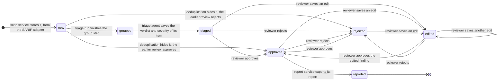
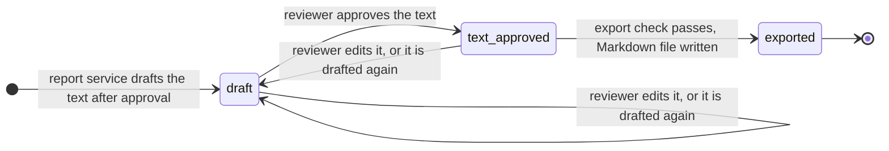

# Finding states

This document shows every state a finding can be in and what moves it from one state to the next. The review screen (T5.1) and the export check of requirement F5 follow it.

A finding is one row of `findings` in one scan (docs/database.md). Its state is not stored in a column. It follows from the other tables: the triage run of its scan, the verdict of its triage item, its reviews and edits, and the reports it is in. The last section gives the rules, and the SQL that computes them.

## State diagram



## States

| State | Meaning | Set by |
|---|---|---|
| `new` | stored from a plug-in run's SARIF file, deduplication hasn't run on its scan yet | scan service, SARIF adapter |
| `grouped` | deduplication has run. The finding is in a duplicate group, or it is a triage item on its own, because a finding without duplicates has no group. It has no verdict yet. | triage agent, group step |
| `triaged` | its triage item has a verdict (true positive, false positive or unsure), reasoning, cited lines and a CVSS v4.0 severity. Waiting for the reviewer. | triage agent, check and score steps |
| `edited` | the reviewer saved changes to the verdict, the reasoning or the severity, and hasn't decided on the changed finding yet | reviewer |
| `approved` | the latest review decision is approve, and it covers the latest edit, if there is one. Only an approved finding gets a report. | reviewer, or an earlier review carried over |
| `rejected` | the latest review decision is reject. The finding stays in the store, so a repeated scan can match it. | reviewer, or an earlier review carried over |
| `reported` | a report that covers it has been exported to `./exports` | report service |

Approved covers both "approved as the AI left it" and "approved with edits": an edited finding becomes approved when the reviewer approves it. The AI's verdict is never overwritten. Edits are stored next to it (docs/database.md, `finding_edits`).

## Transitions

| From | To | Caused by | Notes |
|---|---|---|---|
| | `new` | scan service | one row per SARIF result, in the format of docs/finding-format.md |
| `new` | `grouped` | triage agent, group step | sets `grouped_at` on the scan's triage run |
| `new` | `approved` or `rejected` | deduplication | only when the finding is hidden, see "When a repeated scan finds it again" |
| `grouped` | `triaged` | triage agent | A group is checked and scored once, so all its members become triaged together. If the run stops at its budget, the item stays `grouped`, and the next run picks it up. |
| `triaged` | `approved`, `rejected` | reviewer on the finding detail | saves a review with the reviewer, the time and the decision |
| `triaged`, `approved`, `rejected` | `edited` | reviewer saves an edit | An edit after an approval undoes it: the approval was for the text before the edit, and the report is drafted from the finding as the reviewer left it. |
| `edited` | `approved`, `rejected` | reviewer | the review records which edit it decided on |
| `approved` | `rejected`, and back | reviewer | The latest review counts. A finding that was approved and later rejected can't be exported (F5, test 1). |
| `approved` | `reported` | report service, on export | only after the export check below passes |

`reported` is final. The exported file has left Sieve, so the API refuses new reviews and edits on a reported finding. If the researcher changes their mind, they withdraw the report by hand, and the next scan of the repository shows the finding again only if its code changed.

## Only an approved finding can reach reported

The report service checks this at export, so no client gets around it, including the CLI and the evaluation harness (requirement F5). It refuses the export when:

- the report's current text is not approved. The report service drafts the text after the finding is approved. Drafting it again or editing it after a person approved it undoes that approval.
- the report is for one finding, and that finding is not `approved`.
- the report is for a duplicate group, and a member is `new`, `grouped`, `triaged` or `edited`, so it has no decision yet.
- no finding in the report is `approved`.

A rejected member of a group doesn't block the group's report. It is left out of it, for example when deduplication put it in the wrong group. The report lists the members it covers, each with the review that approved it.

The report's text has its own small cycle:



## When a repeated scan finds it again

A repeated scan doesn't reuse finding rows. It stores new findings, and deduplication links each one to the latest earlier finding of the same repository with the same fingerprint (`matched_finding_id`, docs/database.md). What happens to the new finding's state depends on the rules in docs/finding-format.md, "When a finding is hidden":

| Case | State of the new finding |
|---|---|
| An earlier finding with this fingerprint has a review, the context hash is the same, neither finding is ambiguous (except in two scans of the same commit with the same tool and rules versions), the tool is not Gitleaks, and the earlier finding wasn't edited after its review | Hidden from the review queue. Deduplication sets `hidden` and stores the latest earlier review in `carried_review_id`, so it goes from `new` straight to `approved` or `rejected`. Requirement F5 counts it with that decision. No report is drafted for it again. |
| An earlier finding matches, but any of those rules fails, for example the code around it changed | Shown again. `hidden` is false, so it goes `new`, `grouped`, `triaged` like any other finding, and the review screen shows the review in `carried_review_id` as a suggestion. |
| No earlier finding has this fingerprint | A new finding, from `new` as usual. |
| An earlier finding is not found by the new scan | Nothing changes. The earlier finding keeps its state in its own scan. |

The earlier finding's state never changes because of a later scan. Every scan keeps its own findings and decisions.

## How the state is worked out

The first rule that matches gives the state:

| Order | State | Rule |
|---|---|---|
| 1 | `reported` | the finding is in `report_findings` of a report with status `exported` |
| 2 | `edited` | it has an edit in `finding_edits`, and the review that counts didn't decide on the latest one |
| 3 | `rejected` | the review that counts is a reject |
| 4 | `approved` | the review that counts is an approve |
| 5 | `triaged` | its triage item has a verdict: the finding itself, or its duplicate group |
| 6 | `grouped` | a triage run of its scan has `grouped_at` set |
| 7 | `new` | none of the above |

The review that counts is the finding's own latest review, or, if it has none and `findings.hidden` is true, the earlier review in `findings.carried_review_id`. When `hidden` is false, the carried review is only a suggestion and doesn't count.

This SQL view computes the state, and the function gives the reasons an export is refused. We tested both on PostgreSQL 17.5 with the tables of docs/database.md: every case in this document and the three F5 acceptance tests give the state and the refusals described here. The findings store (T2.3) and the report service (T5.2) can start from them.

```sql
create view finding_states as
select
  f.id as finding_id,
  f.scan_id,
  f.group_id,
  case
    when exists (
      select 1 from report_findings rf join reports r on r.id = rf.report_id
      where rf.finding_id = f.id and r.status = 'exported'
    ) then 'reported'
    when le.id is not null and (cr.id is null or cr.finding_edit_id is distinct from le.id) then 'edited'
    when cr.decision = 'reject' then 'rejected'
    when cr.decision = 'approve' then 'approved'
    when v.id is not null then 'triaged'
    when exists (
      select 1 from triage_runs t where t.scan_id = f.scan_id and t.grouped_at is not null
    ) then 'grouped'
    else 'new'
  end as state,
  cr.id as counting_review_id,
  (own.id is null and cr.id is not null) as carried
from findings f
left join lateral (
  select r.* from reviews r where r.finding_id = f.id order by r.created_at desc limit 1
) own on true
left join lateral (
  select r.* from reviews r where f.hidden and r.id = f.carried_review_id
) car on true
left join lateral (
  select coalesce(own.id, car.id) as id,
         coalesce(own.decision, car.decision) as decision,
         case when own.id is not null then own.finding_edit_id else car.finding_edit_id end as finding_edit_id
) cr on true
left join lateral (
  select e.id from finding_edits e where e.finding_id = f.id order by e.created_at desc limit 1
) le on true
left join lateral (
  select v.id from verdicts v
  where v.finding_id = f.id or (f.group_id is not null and v.group_id = f.group_id)
  order by v.created_at desc limit 1
) v on true;

create function export_refusals(p_report uuid) returns table (reason text) language sql stable as $$
  with r as (select * from reports where id = p_report),
  latest_text as (
    select t.* from report_texts t join r on t.report_id = r.id order by t.version desc limit 1
  ),
  members as (
    select s.finding_id, s.state from finding_states s, r
    where (r.finding_id is not null and s.finding_id = r.finding_id)
       or (r.group_id is not null and s.group_id = r.group_id)
  )
  select 'report is already exported' from r where r.status = 'exported'
  union all
  select 'report has no text' where not exists (select 1 from latest_text)
  union all
  select 'current report text is not approved' from latest_text where approved_at is null
  union all
  select 'finding ' || finding_id || ' is ' || state || ', not decided'
    from members where state in ('new', 'grouped', 'triaged', 'edited')
  union all
  select 'no approved finding in the report'
    where not exists (select 1 from members where state = 'approved')
$$;
```

The export writes the file only when `export_refusals` returns no rows. It then sets the report to `exported`, and fills `review_id` in `report_findings` for each approved member, in the same transaction.
