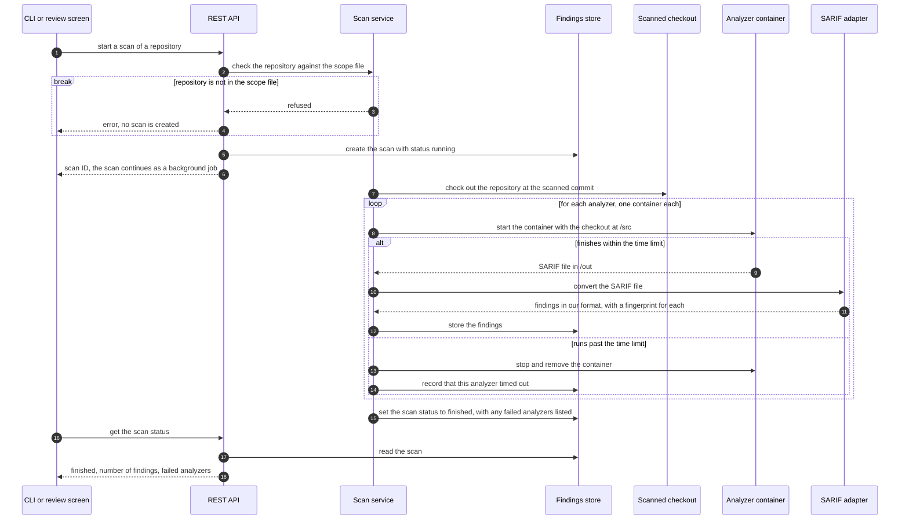
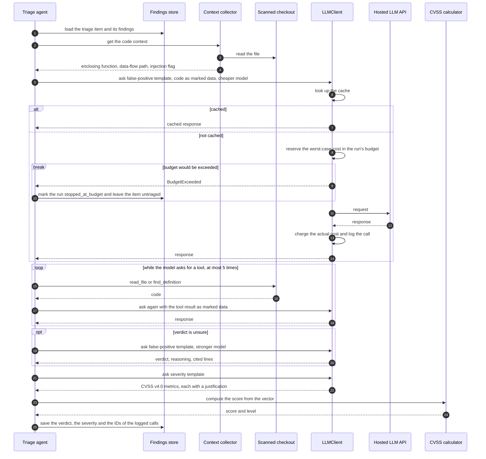
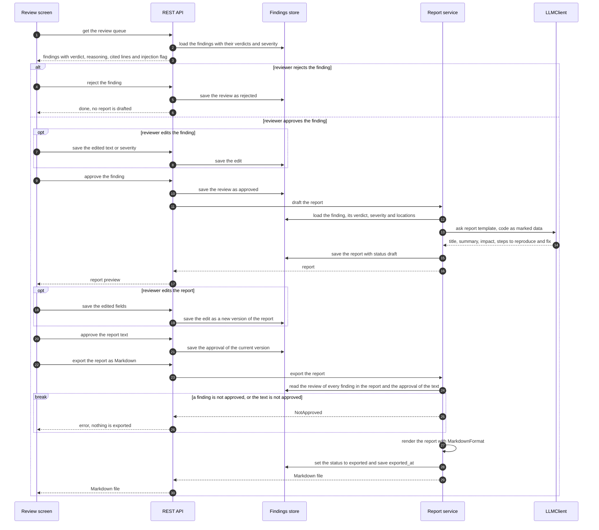

# Sequence diagrams

Three diagrams show the main interactions step by step: scanning a repository and importing its findings, triaging one finding, and approving and exporting a report. Each one shows its main error path.

## Scan and import

The researcher starts a scan from the command line or the review screen. The scan service checks the repository against the scope file, runs one container per analyzer, converts each analyzer's SARIF file to our finding format and stores the findings. Scans take minutes, so the API starts the scan as a background job and returns right away, and the client reads the scan's status until it is finished. Triage starts after this, once per scan.

Notes on the steps:

- The scope check happens before anything is created or started. A repository that is not in the scope file gets an error and no scan record (requirement F2).
- The client repeats the status request while the status is `running`. Only the last request is shown.
- Each analyzer runs in its own container with the checkout at `/src` and writes its results to `/out`. The Java plug-in builds the project with Maven inside its container before it runs SpotBugs.
- When an analyzer runs past its time limit, the scan service stops its container and goes on with the next analyzer. The scan still finishes, with that analyzer listed as failed, so the researcher knows its findings are missing. An analyzer that exits with an error or writes no valid SARIF file is handled the same way.
- Every adapter fills in a fingerprint when its tool doesn't provide one, so the same finding in a repeated scan of the same repository can be matched to the first one.
- The checkout is kept after the scan, because the triage agent's tools read from it.

## Triage of one finding

Grouping runs once per scan before this, so the item can be a single finding or a duplicate group. The triage agent checks the item with the cheaper model first, and asks the stronger model only when the cheaper one is unsure. It then has the LLM choose the CVSS v4.0 metrics and computes the score itself.

Notes on the steps:

- Every `ask` goes through the same cache and budget steps shown for the first one. If the budget runs out at any call, the run stops there. Items that were already saved keep their results, and the next run picks up the rest.
- The context collector extracts the enclosing function with tree-sitter, which has grammars for Python, Java and JavaScript/TypeScript, so the same steps work for all three languages. It also flags comments and strings that look like instructions to an AI. The flag is saved with the verdict, and the review screen shows it.
- The agent's tools read only from the scanned checkout.
- The model chooses the metrics, and the calculator computes the score with FIRST's CVSS v4.0 algorithm. In evaluation runs on CVEs that only have a v3.1 vector, the agent also asks for v3.1 metrics.
- The saved call IDs link every verdict and every metric choice to its prompt and response in the LLM calls table (requirement N3).

## Approval and export

The reviewer decides on each finding on the review screen. A rejected finding never gets a report. When a finding is approved, the report service drafts its report through `LLMClient`. The reviewer edits the text if needed and approves it, and only then is it exported. The report service checks both approvals again at export, so nothing leaves Sieve for a finding that is not approved or for text that no person approved (requirement F5).

Notes on the steps:

- A rejected finding is not deleted. It stays in the findings store with its review, so a repeated scan matches it by its fingerprint and doesn't show it again.
- The `ask` goes through the same cache and budget steps as in the triage diagram. If the budget has run out, no draft is created and the approval stays saved.
- The report is drafted from the finding as the reviewer left it, including edits to its text or severity. The references include at least the finding's CWE.
- The reviewer can change any field of the report before export. An edit, or a new draft from the LLM, is saved as a new version and cancels the approval of the earlier one, so the reviewer approves the text again. The export uses the latest version, and only when that version is approved.
- The `NotApproved` check at export is a second guard. In normal use it passes, because the export button stays disabled until the finding and the text are approved, but it also stops a direct call to the API for a finding or a text that was never approved.
- The report is exported as one Markdown file in the layout from docs/interfaces.md. The HackerOne and Bugcrowd formats are stretch goals and are not shown.
