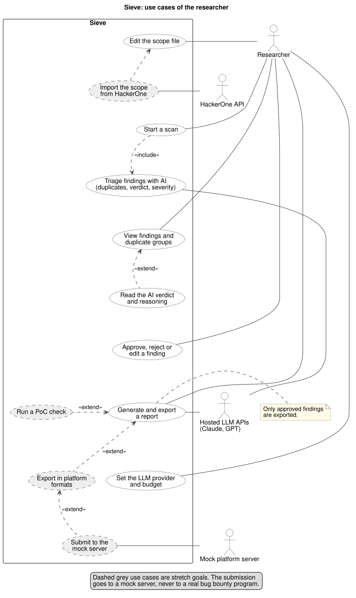

# Use cases

This is what Sieve does for its user, before the screens and the API are built. The diagram source is [use-cases.puml](use-cases.puml) and the exported picture is [use-cases.svg](use-cases.svg). To change the diagram, edit the .puml file and export it again with `plantuml -tsvg docs/use-cases.puml`.

## Actors

The researcher is the only person who uses Sieve: someone who reviews public source code, for example on an open-source bug bounty program. The hosted LLM APIs (DeepSeek, Claude, GPT and others) are an outside service that Sieve calls during triage and report writing, and they only receive public code. The HackerOne API is an outside service used only by the stretch goals.

## Use cases

1. Edit the scope file. The researcher lists the repositories Sieve may scan. A scan of any repository that is not listed is refused.
2. Start a scan. The researcher starts a scan of a listed repository from the web app or the command line. Sieve runs the analyzers and stores their findings, then triages them (use case 3).
3. Triage findings with AI. After every scan Sieve groups duplicate findings, asks the LLM for a verdict on each finding, and scores its severity. The researcher does not start this step, it is part of every scan.
4. View findings and duplicate groups. The researcher sees the findings of a scan on the review screen, with duplicates shown together as one group.
5. Read the AI verdict and reasoning. From the list the researcher opens a finding and sees the verdict (true positive, false positive or unsure), the reasoning, the cited code lines and the CVSS severity.
6. Approve, reject or edit a finding. The researcher decides on each finding, and can correct its text or severity before approving it.
7. Generate and export a report. For every approved finding Sieve drafts a report with a summary, impact, steps to reproduce, a fix and references. The researcher edits and approves its text, and only then is it exported as Markdown. Rejected and unreviewed findings are never exported.
8. Set the LLM provider and budget. The researcher chooses which hosted model Sieve uses and the most a run may spend. A run stops when the next call would go over the budget.

## Stretch use cases

These are only started after the minimum viable product works (week 7).

9. Import the scope from HackerOne. Sieve reads a program's in-scope assets through the HackerOne API, and refuses to report on assets outside that scope. It extends use case 1.
10. Run a PoC check. Sieve writes steps to reproduce a finding and runs them against a local Docker copy of the application, then marks the finding as verified. It extends use case 7.
11. Export in platform formats. The report is filled into the HackerOne and Bugcrowd report forms. It extends use case 7.
12. Submit to the mock server. The formatted report is sent to a mock platform server, so submission can be tested without contacting a real program. It extends use case 11.
